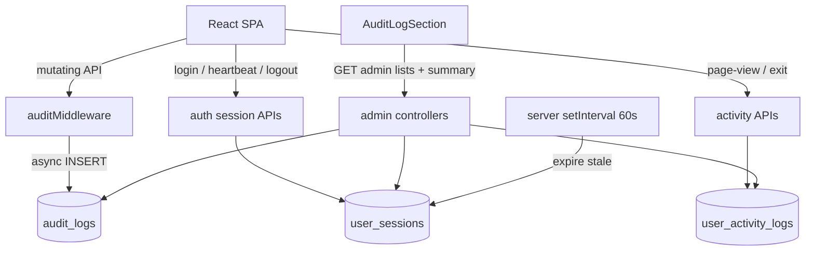

# DigiLog Audit & Activity Tracking

Plant admins read this under **Config → Audit & Activity**. The log is written so a supervisor can answer: who saved what, what was it before, did it fail, who approved it (including from email), and who opened or downloaded data.

Related business overview: `Admin_Audit_Log_Business_Overview.docx`.  
Related Word technical pack: `Admin_Audit_Log_Documentation.docx`.

**Rules:** no API can edit or delete existing audit rows. Filters only add `WHERE`. Passwords and tokens are stripped.

---

## 1. What the three tabs are for

| Tab (UI label) | Table | Question it answers |
|----------------|-------|---------------------|
| **Changes** | `audit_logs` | Who created, edited, deleted, approved, or failed to save data |
| **Views and downloads** | `user_activity_logs` | Who opened a form or dashboard, and who downloaded CSV/PDF |
| **Sign-ins** | `user_sessions` | Login / logout, session length, who is online now |

Night activity by itself is not suspicious during crushing season. Admins look for missing entries, later edits, deletes, failed saves, approvals (including email links), uploads, role changes, and failed sign-ins.

---

## 2. Architecture



| Layer | Responsibility |
|-------|----------------|
| `auditMiddleware.js` | After response finish, write Change rows (non-blocking). Captures `res.json` message. |
| `utils/auditLog.js` | Sanitize body, before/after fields, enrich path → names, plain-English summary |
| `utils/httpError.js` | `sendServerError` stores `res.locals.auditError` for Technical details |
| `utils/sessionActivity.js` | Session + activity DB helpers |
| `ActivityTracker.jsx` | Frontend session lifecycle + page dwell |
| `AuditLogSection.jsx` | Three tabs, chips, summary strip, expandable rows |

Startup: `assertAuditLogsSchema` warns if `audit_logs` is missing any insert column. Insert failures log method, path, and user so the lost row can be traced.

---

## 3. Data model

### 3.1 `audit_logs` (Changes)

Written for `POST` / `PUT` / `PATCH` / `DELETE` that are not skipped.

Key columns: `user_*`, `method`, `path`, `status_code`, `success`, `action_type`, `action_summary`, **`outcome_message`**, **`error_detail`**, `module`, `module_key`, `resource_*`, `display_path`, `screen`, `duration_ms`, `request_body`, `ip`, `user_agent`.

- `outcome_message` — the text the user saw, mapped to Saved / Sent for approval / Already exists / …
- `error_detail` — MySQL code + message from `sendServerError`; shown only under Technical details
- `request_body` — sanitized readable JSON. Edits store `{ field, before, after }`. Deletes store the removed row.
- `display_path` for forms is `Forms Hub › App › Form` (join `forms` → `apps`)
- Email-link approvals set `req.auditActor` from the HOD on the token (`hod_user_id` / `hod_email`)
- Failed sign-ins with an unknown email store person as `Unknown user (tried: email)`

### 3.2 `user_sessions` (Sign-ins)

One row per SPA tracking session (UUID `session_id`).

| Column | Role |
|--------|------|
| `login_at` / `logout_at` | Session bounds |
| `duration_minutes` | Precomputed length |
| `is_active` | Online flag |
| `last_heartbeat` | Keep-alive; stale sessions expire after 5 minutes |
| `pages_visited` | Incremented on page/section/form/dashboard events |

### 3.3 `user_activity_logs` (Views and downloads)

| Column | Role |
|--------|------|
| `session_id` | Links to `user_sessions` |
| `event_type` | `page_view`, `form_open`, `view_data`, `download_csv`, `download_pdf`, … |
| `section` / `card` / `form_or_dashboard` | Cascading filter dimensions |
| `page_path` / `display_path` | Technical + breadcrumb paths |
| `entered_at` / `exited_at` / `dwell_seconds` | Time on page |

Schema sources: `mysql/init.sql`, `mysql/migrate_audit_outcome.sql`, `backend/prisma/migrations/20260805120000_user_sessions_activity/migration.sql`.

---

## 4. APIs

### 4.1 SPA (authenticated)

| Method | Path | Purpose |
|--------|------|---------|
| POST | `/api/auth/session/start` | Create `user_sessions` row; returns `{ session_id }` |
| POST | `/api/auth/session/heartbeat` | Touch `last_heartbeat` |
| POST | `/api/auth/logout` | Close open activities + end session |
| POST | `/api/activity/page-view` | Insert activity (body may set `event_type`) |
| POST | `/api/activity/event` | Same as page-view |
| PATCH | `/api/activity/:id/exit` | Set `exited_at` + `dwell_seconds` |

Header: `X-Session-Id`. These write paths are excluded from Changes in `shouldSkipAudit()`.

### 4.2 Admin (role `admin`)

| Method | Path | Purpose |
|--------|------|---------|
| GET | `/api/admin/audit-logs` | Changes list (`q`, `action`, `success`, `from`, `to`, `quick`, tree filters, paging) |
| GET | `/api/admin/audit-logs/summary` | Counts for selected dates: saved, sent for approval, approvals, edits, deletes, failed |
| GET | `/api/admin/activity-logs` | Views list (`section`, `card`, `form_or_dashboard`, …) |
| GET | `/api/admin/sessions` | Sign-ins list (`active`, …) |
| GET | `/api/admin/audit-filter-options` | Cascading options |

`quick` values: `problems`, `edits`, `approvals`, `uploads`, `logins`.

Filters never rewrite stored rows. Forms card filter matches through `forms` → `apps.name` so older rows still appear under the card. Approvals includes Operations forms (`/form-approvals`, `/form-approval/`) and Maintenance Notes.

---

## 5. Change pipeline

1. `shouldSkipAudit` — skip GETs, health, admin list reads, activity/session bookkeeping, hierarchy `/link` & `/sync-name`.
2. For `…/specs` PUTs: `captureSpecsBefore` so the summary can diff subsection names.
3. Wrap `res.json` so the response `message` is stored as `outcome_message`.
4. Controllers set `req.auditBefore` on form edit/delete and employee role/active updates.
5. Token approval routes set `req.auditActor` from the HOD.
6. On `res.finish`: `setImmediate` → sanitize body → `enrichAuditContext` → `buildChangeDescription` → INSERT.

Failures in audit insert never fail the original request. The console line includes method, path, and user.

Example summaries:

- `Ravi Kumar saved Mill Stoppages for 04-Nov-2026, Shift B`
- `Ravi Kumar sent Mill Stoppages for 04-Nov-2026, Shift B for approval`
- `Could not save Mill Stoppages: entry already exists for this shift`
- `HOD Suresh approved Laboratory (from email)`

---

## 6. Session lifecycle

1. **Login / restore** — SPA calls `POST /auth/session/start`; stores `session_id` in `sessionStorage` + `localStorage` (`digilog_session_id`).
2. **Heartbeat** — every 60s `POST /auth/session/heartbeat`; `pagehide` uses `navigator.sendBeacon` when possible.
3. **Logout** — `POST /auth/logout` then clear JWT / session id (AuthContext).
4. **Stale expiry** — `server.js` interval every 60s marks sessions inactive when `last_heartbeat` older than 5 minutes.

---

## 7. Activity / dwell tracking

`ActivityTracker` (under `AuthProvider` + `BrowserRouter`):

1. Ensures a tracking session while `user` is set.
2. On route change: exit previous activity, then `POST /activity/page-view` with labels from `classifyPath()`.
3. UI maps event codes to Opened form / Viewed data / Downloaded CSV / Downloaded PDF / Downloaded chart / Opened page.

---

## 8. Admin UI

File: `frontend/src/components/admin/config/AuditLogSection.jsx`  
Config tab id: `audit-log` (label **Audit & Activity**).

**Changes:** Time (IST + relative), Person, What happened, Where, Result chip (Saved / Sent for approval / Failed / …). Expand: What was entered / What changed / What was deleted / What went wrong / Technical details.

Quick chips: Today, Yesterday, This week, Problems only, Edits and deletes, Approvals, Uploads, Sign-ins.

Summary strip counts are clickable filters.

**Views and downloads:** event labels, Form/Dashboard column, row expand.

**Sign-ins:** login / logout / duration / online.

Area cascade: Home → Forms Hub → Forms cards → Mill House, Approvals → Operations forms, Data Upload, Config.

---

## 9. Production apply

From `DigiLog/backend` (with production `.env`):

```bash
node scripts/apply-sql-file.js ../mysql/migrate_audit_outcome.sql
```

That adds `outcome_message` and `error_detail`. Restart the backend so the startup column check is clean.

---

## 10. Source file index

| Path | Role |
|------|------|
| `backend/middleware/auditMiddleware.js` | Change writer + schema check |
| `backend/utils/auditLog.js` | Enrichment, summaries, actors |
| `backend/utils/auditFilterMap.js` | Area cascade SQL |
| `backend/utils/httpError.js` | `auditError` on server failures |
| `backend/controllers/auditLog.controller.js` | List + summary |
| `backend/controllers/sessionActivity.controller.js` | Session/activity writes |
| `backend/controllers/activityAdmin.controller.js` | Admin activity/session/filters |
| `frontend/src/components/admin/config/AuditLogSection.jsx` | Admin UI |

---

## 11. Out of scope (later)

Entry history on View Data, person timeline, flags (late edits, many deletes), 8 AM digest email, missing-entries tracker (comes from form tables, not this log), CSV export of logs, retention policy.
