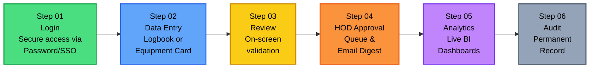
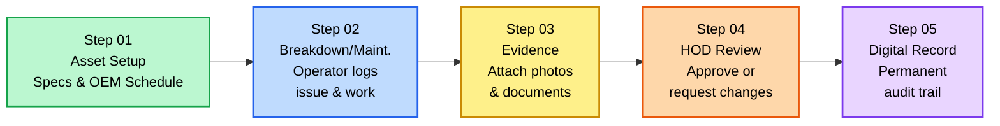
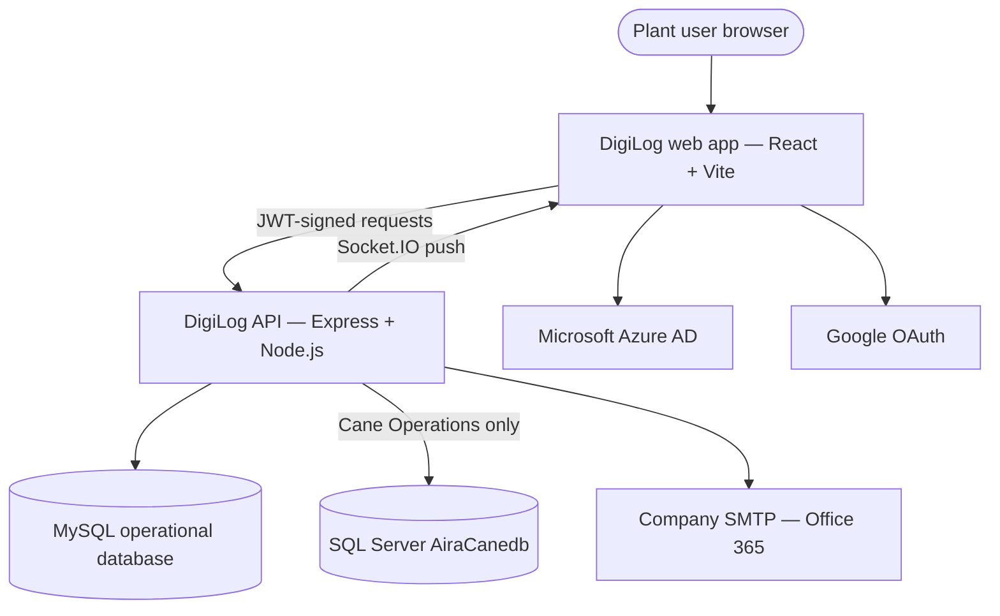

# DigiLog — Comprehensive Functional and Business Document

> **Audience:** Business heads, plant leadership, functional owners, and anyone who needs to understand the complete application  
> **Organization:** Zuari Industries (GSMA plant operations — Gobind Sugar Mill)  
> **System:** DigiLog — digital logbook, equipment history, and plant analytics  
> **Last verified against source:** 8 October 2026  
> **Repository:** `DigiLog/`  
> **Classification:** Internal — business use  
> **Companion technical note:** `docs/PROJECT.md` and `docs/DigiLog_Technical_Documentation.md` (engineer audience)

This document describes **everything** DigiLog does — every screen, every button, every form field, every click action, and every business rule. It is written so that a person who has never opened the application can understand exactly what happens at every point.

---

## Table of Contents

1. [Executive Summary](#1-executive-summary)
2. [Business Problem DigiLog Addresses](#2-business-problem-digilog-addresses)
3. [Who Uses It — Roles and Access](#3-who-uses-it--roles-and-access)
4. [Screen-by-Screen Navigation Map](#4-screen-by-screen-navigation-map)
5. [Daily Operational Workflow](#5-daily-operational-workflow)
6. [Functional Catalogue](#6-functional-catalogue)
   - 6.1 [Operations Forms (All 28 Forms Detailed)](#61-operations-forms)
   - 6.2 [Equipment Maintenance and History](#62-equipment-maintenance-and-history)
   - 6.3 [Power BI Dashboards (BI Control Tower)](#63-power-bi-dashboards-bi-control-tower)
   - 6.4 [Data Ingestion Centre](#64-data-ingestion-centre)
7. [Approval and Governance](#7-approval-and-governance)
8. [Notification System](#8-notification-system)
9. [Administration — Complete Config Reference](#9-administration--complete-config-reference)
10. [Security in Business Language](#10-security-in-business-language)
11. [Technology Stack](#11-technology-stack)
12. [Operating Picture](#12-operating-picture)
13. [Decisions Still Open for Leadership](#13-decisions-still-open-for-leadership)
14. [Glossary](#14-glossary)
15. [Document History](#15-document-history)

---

## 1. Executive Summary

DigiLog is the plant's operating system for **shift records, laboratory and process logbooks, environment and safety reporting, equipment life history, and management analytics**.

It replaces paper registers for sugar (cane, mill, boiling house, laboratory), power, distillery (ethanol), and EHS. Operators enter data once. Department heads can be required to approve selected entries before they stand as official. Leadership sees the same numbers in a **BI Control Tower**: cane, milling, sugar, power, and distillery on one management scorecard, plus specialist dashboards for cane quality, grower performance, and power-house operations.

Access is not open to everyone. An administrator provisions each person, assigns the apps they may open, and can restrict them to specific forms. Sign-in is by company password, Microsoft (Outlook), or Google. Every signed-in session and important create / update / delete action can be audited.

**Business outcome:** one controlled record of what happened on the shift, what was maintained on the asset, and how the season is performing — visible to the people who are allowed to see it, and reviewable by the head of department when approval is switched on.

---

## 2. Business Problem DigiLog Addresses

| # | Before (Paper / Scattered Sheets) | With DigiLog (Centralized & Digital) |
|---|---|---|
| 1 | **Shift sheets live in binders and personal spreadsheets.** Data is siloed and hard to search. | **Entries are captured in named digital logbooks** tied securely to the date, shift, and specific user. |
| 2 | **The same reading can be written down twice**, or impossible numbers (like a pH of 20) can be recorded by mistake. | **Validation checks reject bad entries** (e.g., pH must be 0–14 on G shift for ETP) and prevent duplicate rows before they are stored. |
| 3 | **Consolidation for the daily meeting is manual.** Someone has to spend hours copying data from paper into Excel. | **Dashboards automatically calculate indicators** (cane, mill, sugar, power, distillery) for WTD, MTD, and STD, and can instantly compare seasons. |
| 4 | **Equipment history is kept on physical paper cards or isolated files** that can be lost or are hard to access during a night shift. | **Assets have a centralized digital card.** It holds specifications, OEM schedules, and a permanent maintenance history with attached photos. |
| 5 | **"Who changed this number?" is hard to answer** when using shared spreadsheets or paper. | **Audit logs, session tracking, and approval history** permanently record the action, the person, and the before/after values. |
| 6 | **Grower and cane data arrives in scattered Excel files** via email. | **A dedicated Data Ingestion Centre** securely loads and tracks Purchy, Management, and Milling files for authorized users. |
| 7 | **Accident records are scattered across departments** with no central registry. | **EHS forms capture Near Miss/Accident Reports** with severity, treatment, photos, and document uploads in one place. |
| 8 | **Water consumption and effluent data is tracked manually** across bore wells and treatment plants. | **Three dedicated EHS water forms** (Ground Water Abstraction, ETP Working, CPU Water Recycle) with auto-calculated totals. |

---

## 3. Who Uses It — Roles and Access

### 3.1 User Roles

| Role | What they do | How the system treats them |
|---|---|---|
| **Operator / chemist / shift staff** (role: employee) | Fill logbooks, record stoppages, sample Brix, log EHS events, update equipment history | Sees only the homepage cards, apps, and forms an admin has mapped to them. Can be set to **Forms Hub view-only** (read, not submit). When view-only is ON, a yellow banner appears at the top of every form: "You have view-only access to Forms Hub." The submit button is hidden. |
| **Head of Department (HOD)** | Reviews queued form entries and maintenance-history changes; accepts, sends back for modification, or rejects | Named as the HOD on an approval setting. Receives in-app notifications and scheduled email digests. Does not need the admin role. Gets an **"Approvals" icon** in the navbar. |
| **Administrator** | Creates employees, departments, app mappings, season dates, BI constants, and approval rules; reads the audit log | Separate admin sign-in at `/admin/login`. Cross-portal login (employee using the admin door, or the reverse) is blocked. Gets a **"Config" icon** in the navbar. |
| **Leadership / management** | Reads the management scorecard and the dashboards they are mapped to | Same employee account, with the BI Control Tower card and the specific dashboards assigned. |
| **Data owner** (cane / purchy / milling) | Uploads Excel or CSV into the Data Ingestion Centre | Upload rights are granted per section (Purchy, Management Dashboard, Milling), not to every user. Gets a **"Data Upload" icon** in the navbar. |

### 3.2 Homepage Cards

Homepage cards an employee can be given (assigned in Admin → Employees):

| Card Key | Card Name | What clicking it opens |
|---|---|---|
| `forms_hub` | **Forms Hub** | Navigates to `/forms-hub` — the two-category landing page (Operations forms / Equipment maintenance and history) |
| `bi_control_tower` | **BI Control Tower** | Navigates to `/bi` — the analytics dashboard hub |

- An employee with **both cards** sees a two-column layout with large illustrated cards.
- An employee with **one card** sees a single centered card.
- An employee with **neither card** sees: *"No homepage destinations assigned. Contact your admin to assign Forms Hub and/or BI Control Tower cards."*

### 3.3 App and Form Mapping

Within each homepage card, the admin further controls what the employee sees:

- **App Mapping:** Checkboxes for each app (Mill Logbook, Lab Logbook, Power Logbook, EHS, Production, Brix Sampling, Distillery, equipment history apps). An employee only sees the app cards they are mapped to.
- **Form-Level Restriction:** Within each app, the admin can optionally restrict to specific forms. If left empty, the employee sees **all forms** in that app. If filled, they see **only the listed forms**.
- **Dashboard Mapping:** For BI Control Tower, individual dashboards (Management, Cane Performance, Milling Operations, etc.) can be assigned.

---

## 4. Screen-by-Screen Navigation Map

This section documents **every screen** and what the user sees at each point. It is designed so that a person who has never opened the application can understand exactly what happens at every click.

### 4.1 Marketing Landing Page (Public — Unauthenticated)

**URL:** `/`  
**Who sees it:** Anyone who is not logged in.  
**Purpose:** Public-facing marketing page describing DigiLog to potential stakeholders.

**Page Structure (top to bottom):**

| Section | Elements | What each element does |
|---|---|---|
| **Top Navigation Bar** | Zuari Industries logo (left), DigiLog brand mark (center-left), "Sign In" button (right) | Zuari logo links externally to `zuariindustries.in`. DigiLog brand mark is text only. "Sign In" button opens the Login Modal (see 4.2). |
| **Hero Section** | Large heading: *"Forms, Analytics & Secure AI. Unified in your digital logbook."* Subtext describing sugar, power, and ethanol divisions. | Pure marketing text. No interactive elements except scroll. Background has a mesh gradient effect. |
| **Operations Desk Preview** | An interactive demo card (`OperationsDeskCard` component) | Shows a sample of what the operations desk looks like. This is a marketing preview, not a functional tool. |
| **Three Pillars Section** | Three cards: "Digitized Plant Floors" (Connected Forms), "Automated Dashboards" (Real-Time Analytics), "Intelligent Diagnostics" (Secure AI Insights) | Each card has an icon, title, and description. **Note: Pillar 3 (Secure AI) is marketing copy only — it is NOT built in the product.** |
| **Divisions Section** | Three cards: Sugar Division, Power Division, Ethanol Division | Each lists 4 bullet points of what DigiLog handles for that division. Hover effect on cards. |
| **Transformation Section** | Four cards showing before/after comparisons | "Digitized Forms that don't suck", "Live Dashboards in seconds", "AI Early Warnings" (not implemented), "One Unified Hub". Each has a visual mockup illustration above the text. |
| **Security Section** | Four numbered steps describing "Zero-Data Query Architecture" | Step 1: Schema-Only Transfer, Step 2: AI Writes the Query, Step 3: Executed Internally, Step 4: Summarized Output Only. **This entire section describes an AI feature that is NOT built.** |
| **Footer** | DigiLog logo, copyright text | © 2026 DigiLog. All rights reserved. |

**Keyboard shortcut:** Pressing `Escape` closes the login modal if it's open.

---

### 4.2 Employee Login Modal

**Trigger:** Clicking "Sign In" on the marketing page, or navigating to `/?login=1`.  
**Type:** Full-screen overlay modal with a blurred backdrop.

**Exact elements from top to bottom inside the modal:**

| # | Element | Type | What it does |
|---|---|---|---|
| 1 | **Header row** | Bar | Left: Zuari Industries logo + "SSO Portal" badge. Right: Close (X) button. |
| 2 | **Title** | Text | "Sign in to DigiLog v1" with subtitle "Authenticate your operational logbook session." |
| 3 | **"Sign in with Microsoft" button** | Button (full-width) | Shows a 4-color Microsoft Windows icon. Initiates Azure AD / MSAL **redirect** authentication (not popup). On success, the user is redirected to `/dashboard`. On failure, a toast error appears. If the connection is not HTTPS, shows: "Microsoft sign-in requires a secure (HTTPS) connection." |
| 4 | **"Sign in with Google" button** | Button (full-width) | Uses the Google Identity Services (GIS) library. Opens a Google popup. On success, sends the access token to `POST /api/auth/google`, stores the JWT, and redirects to `/dashboard`. On failure, shows a toast with the error. |
| 5 | **"Sign in with credentials" collapsible** | Accordion | Collapsed by default. Shows a small arrow indicating expand/collapse state. Clicking it toggles the credentials form. |
| 6 | **Email input** (inside collapsible) | Text field | Label: "Username or corporate email". Placeholder: "e.g., operator@zuari.com". Has a person icon on the left. |
| 7 | **Password input** (inside collapsible) | Password field | Label: "Security key phrase / password". Has a lock icon on the left. Placeholder: "••••••••••••". |
| 8 | **"Forgot?" link** (inside collapsible) | Button | Shows a toast: "Contact your IT administrator for password reset." with an ℹ️ icon. Does NOT open a reset flow. |
| 9 | **"Sign In" button** (inside collapsible) | Submit button | Validates: both fields required, email format check. Calls `POST /api/auth/login` with `adminPortal: false`. On success: stores JWT token, shows "Signed in successfully." toast, redirects to `/dashboard`. On failure: shows the error (e.g., "Invalid credentials", "Account not active", "You are not an admin." if they try employee credentials on admin). Loading state shows "Signing in…" with a spinner. |
| 10 | **Backdrop click** | Action | Closes the modal without signing in. |
| 11 | **Escape key** | Action | Closes the modal without signing in. |

**Post-login redirect:** If the URL contains a `?next=/some-path` parameter (e.g., from an email link), the user is redirected to that path instead of `/dashboard` after login.

**Cross-portal blocking:** If an admin-only account tries to sign in through the employee portal, the system returns: *"This account can only sign in through the admin portal."*

---

### 4.3 Admin Login Page

**URL:** `/admin/login`  
**Who sees it:** Administrators only.  
**Visual style:** Dark-themed page (dark background, as opposed to the light employee portal).

| # | Element | What it does |
|---|---|---|
| 1 | **DigiLog brand mark** | Shows "DigiLog v1" with "Administrator sign-in" subtitle. |
| 2 | **Email input** | Admin email address. Standard text input. |
| 3 | **Password input** | Admin password. Masked input. |
| 4 | **"Sign in" button** | Calls `POST /api/auth/login` with `adminPortal: true`. On success: stores JWT, redirects to `/admin/config?section=employees`. On failure: if a non-admin employee tries this, returns "You are not an admin." |

**No SSO options:** Admin login does not offer Microsoft or Google sign-in — only email/password.

---

### 4.4 Homepage (Authenticated Employee Dashboard)

**URL:** `/dashboard`  
**Who sees it:** Any authenticated employee.  
**Route protection:** If not authenticated, redirected to `/` (marketing landing).

**Page layout:**

| # | Element | What it does |
|---|---|---|
| 1 | **Breadcrumb** | "Zuari Industries · DigiLog" (small uppercase text, clickable — links to `/`). |
| 2 | **Greeting** | "Hello, [First Name]" — e.g., "Hello, Vivek". Uses only the first word of the user's full name. |
| 3 | **Subtitle text** | "Pick a destination. Forms Hub opens your assigned operational forms and logbooks; BI Control Tower lists analytics dashboards you are assigned." |
| 4 | **Forms Hub card** (if assigned) | Large illustrated card with image `/forms-hub-illustration.png`. Title: "Forms Hub". Description: "Centralized access to digital operational forms—mill, lab, power, distillery, EHS and equipment history, based on your access." Button: "Open Forms Hub →". Clicking navigates to `/forms-hub`. Gradient top border: blue → indigo → violet. Hover effect: lifts up 1.5px, shadow intensifies. |
| 5 | **BI Control Tower card** (if assigned) | Large illustrated card with image `/bi-control-tower-illustration.png`. Title: "BI Control Tower". Description: "Unified business intelligence: open assigned dashboards from live operational data." Button: "Open BI Control Tower →". Clicking navigates to `/bi`. Gradient top border: violet → indigo → sky. Hover effect: same as above. |
| 6 | **"No homepage destinations assigned"** | Only shown if neither card is assigned. Message: "No homepage destinations assigned" with "Contact your admin to assign Forms Hub and/or BI Control Tower cards." |

**Card layout:** If both cards are assigned, they appear side-by-side on desktop (2-column grid) and stacked on mobile. If only one card is assigned, it is centered with a max-width constraint.

---

### 4.5 Navigation Bar (Navbar — All Authenticated Pages)

The navbar is **sticky** at the top of every page (CSS `sticky top-0 z-50`) for authenticated users. It has a white background with a bottom border and subtle shadow.

**Desktop layout (left to right):**

| # | Element | Visibility | What it does |
|---|---|---|---|
| 1 | **Zuari Industries logo** | Always | External link to `https://www.zuariindustries.in/`. Opens in new tab. Height: 44px max. |
| 2 | **DigiLog brand mark** | Always | Clickable text "DigiLog v1". Navigates to `/` (root). |
| 3 | **Home icon** (MdHome) | Always | Navigates to `/dashboard`. Blue highlight when on `/dashboard`. Label: "Home". |
| 4 | **Approvals icon** (MdFactCheck) | Only if user is a designated HOD | Navigates to `/maintenance/approvals`. Blue highlight when active. Label: "Approvals". |
| 5 | **Data Upload icon** (MdUpload) | Only if user has upload rights for ≥1 section | Navigates to `/data-upload`. Label: "Data Upload". |
| 6 | **Config icon** (MdSettings) | Only if user role = admin | Navigates to `/admin/config`. Blue highlight when on any admin path. Label: "Config". |
| 7 | **User name & department** | Hidden on mobile, visible on sm+ | Shows the user's full name (truncated if long) and department below it. If no department, shows the role (capitalized). |
| 8 | **User avatar button** | Always | Circular button (36×36px on mobile, 40×40px on desktop). Shows the user's avatar photo if uploaded, otherwise shows the first letter of their name on a blue background. Clicking opens the **Profile Modal** (see 4.6). |
| 9 | **Notification bell** (MdNotifications) | Always | Shows the bell icon with a red badge count of unread notifications. Clicking toggles the **Notification Dropdown** (see Section 8). |
| 10 | **Logout button** (MdLogout) | Always | Logs the user out: clears JWT from localStorage, ends the session tracking, disconnects Socket.IO, and redirects to `/?login=1`. If the user logged in via Microsoft, also triggers MSAL logout redirect. Hover: red background. |
| 11 | **Adventz logo** | Hidden on xs, visible on sm+ | External link to `https://www.adventz.com/`. Separated by a left border. |

**Mobile layout:**
- Navigation items (Home, Approvals, Data Upload, Config) are hidden on screens smaller than `md` (768px).
- A **hamburger menu** (MdMenu) button appears instead.
- Clicking the hamburger opens the **Mobile Navigation Drawer** (slides in from the right, 320px wide or 88% of viewport width, whichever is smaller). The drawer contains the user's name/department at the top and all nav items as a vertical list.
- The drawer can be closed by: clicking the X button, clicking the backdrop, or pressing Escape.
- The drawer auto-closes when the URL changes (navigating to a new page).

**Active state:** When a nav item's route matches the current URL, it gets a blue background (`bg-blue-50`) and blue text (`text-blue-700`).

---

### 4.6 Profile Modal

**Trigger:** Clicking the user avatar in the navbar.  
**Type:** Bottom sheet on mobile, centered modal on desktop.

**Default view (no crop in progress):**

| # | Element | What it does |
|---|---|---|
| 1 | **Close (X) button** | Top-right corner. Closes the modal. |
| 2 | **Large avatar circle** | 112×112px rounded circle. Shows the user's current avatar photo or their initial on a blue background. Has a white ring and shadow. |
| 3 | **User name** | Large text showing the full name. |
| 4 | **User email** | Smaller text below the name. |
| 5 | **Department** | Shows "Department" label and the department name. If no department is on file, shows "No department on file". |
| 6 | **"Upload photo (PNG / JPEG)" button** | Primary blue button with a camera icon. Opens the OS file picker. Accepts only `.png`, `.jpg`, `.jpeg` files. Maximum original file size: ~3.5 MB. |
| 7 | **"Remove photo" button** | Only shown if the user has an existing avatar. Shows a confirmation dialog: "Remove your profile photo?" On confirm, calls `DELETE /api/auth/me/avatar`. |
| 8 | **Help text** | "You can crop and center your photo before saving. Only your profile photo can be changed here." |

**Crop view (after selecting a photo):**

| # | Element | What it does |
|---|---|---|
| 1 | **Instruction text** | "Drag to center your face. Pinch or use the slider to zoom." |
| 2 | **Crop area** | 288px tall dark area with a circular crop overlay (using `react-easy-crop`). User can drag to reposition and pinch/scroll to zoom. |
| 3 | **Zoom slider** | Range input from 1× to 3× zoom with 0.01 step increments. Label: "Zoom". |
| 4 | **"Cancel" button** | Discards the selected image and returns to the default view. |
| 5 | **"Save photo" button** | Crops the image to 384×384px at 88% JPEG quality. If the result exceeds 450 KB, re-crops at 280×280px at 82% quality. If still too large, shows: "Image is still too large after crop. Try a simpler photo or smaller original." Otherwise uploads via `POST /api/auth/me/avatar` as a FormData with field name `avatar`. Shows "Profile photo updated." toast on success. |

---

### 4.7 Forms Hub Landing

**URL:** `/forms-hub`  
**Who sees it:** Employees with the Forms Hub homepage card assigned.

| # | Element | What it does |
|---|---|---|
| 1 | **Breadcrumb** | Dashboard > Forms Hub |
| 2 | **Page title** | "Forms Hub" |
| 3 | **Subtitle** | "Select a category to view your assigned applications." |
| 4 | **"Operations forms" card** | Large illustrated card with image `/operations-forms-illustration.jpg`. Gradient top border: blue → indigo → violet. Description: "Access your daily operational logbooks including mill, lab, power, distillery, and EHS forms." Button: "View Operations →". Clicking navigates to `/forms-hub/operations`. |
| 5 | **"Equipment maintenance and history" card** | Large illustrated card with image `/equipment-maintenance-illustration.jpg`. Gradient top border: violet → indigo → sky. Description: "Browse equipment hierarchy, view specifications, OEM schedules, and log maintenance history." Button: "View Equipment →". Clicking navigates to `/forms-hub/equipment`. |

**Layout:** Two cards side-by-side on desktop, stacked on mobile. Both cards have the same elevated shadow and lift-on-hover animation as the homepage cards.

---

### 4.8 Forms Hub Category Page

**URL:** `/forms-hub/operations` or `/forms-hub/equipment`  
**Who sees it:** Employees navigating from the Forms Hub landing.

| # | Element | What it does |
|---|---|---|
| 1 | **Breadcrumb** | Dashboard > Forms Hub > [Operations forms / Equipment maintenance and history] |
| 2 | **Page title** | "Operations forms" or "Equipment maintenance and history" |
| 3 | **User info** | "Signed in as [Name]" |
| 4 | **App card grid** | Responsive grid: 1 column on mobile, 2 on sm, 3 on lg, 4 on xl. Each card shows the app's icon (color-coded), name, description, and a form count badge (e.g., "6 Forms"). |
| 5 | **Empty state** | If no apps are assigned for this category: an MdApps icon with "No [equipment/operations] applications assigned" and "Contact your admin to get access." |

**App classification logic:**
- **Equipment apps** (shown under `/forms-hub/equipment`): Power Plant Equipment History, Sugar House Equipment History, Production House Equipment History, Mill House Equipment History, Power Plant Equipment History (old)
- **Operations apps** (shown under `/forms-hub/operations`): Everything else (Mill Logbook, Lab Logbook, Power Logbook, EHS, Distillery, Production, Brix Sampling, etc.)
- The BI Control Tower app is filtered out from Forms Hub entirely.
- Retired apps (Mill House Equipment History, Power Plant Equipment History old) are also filtered out.

---

### 4.9 App Detail Page

**URL:** `/apps/:appId`  
**Who sees it:** After clicking an app card.

| # | Element | What it does |
|---|---|---|
| 1 | **Breadcrumb** | Dashboard > Forms Hub > [App Name] |
| 2 | **App header** | Shows the app name, description, and color-coded icon. The `GSMA -` prefix is stripped from display names. |
| 3 | **Forms table** | A table listing all forms in the app. Columns: Form Name, form count. Header text is "Available Forms" for regular apps or "Available dashboards" for BI. Shows "[N] form(s) available". |
| 4 | **Auto-redirect for single-form apps** | If an app has only one form and that form has a known hub route, the user is automatically redirected to that form's page without seeing the app detail page. |

---

### 4.10 BI Control Tower Hub

**URL:** `/bi`  
**Who sees it:** Employees with the BI Control Tower homepage card assigned.

| # | Element | What it does |
|---|---|---|
| 1 | **Breadcrumb** | Home > BI Control Tower (in a pill-shaped container with backdrop blur). |
| 2 | **View toggle** | Grid view / List view buttons (icon-only, in a pill container). Grid shows bento-style cards. List shows a compact vertical layout. The preference is saved to `localStorage` and persists across sessions. |
| 3 | **Dashboard count** | "[N] dashboards" pill badge. |
| 4 | **Dashboard cards** | Each card represents an assigned dashboard (Management, Cane Performance, Milling Operations, Power House, Distillery, Purchy Analysis, Brix Sampling, Centre Maturity). Clicking a card navigates to the dashboard page. |
| 5 | **Empty state** | "No BI dashboards assigned. An administrator can assign the BI Control Tower app or individual dashboards to your account under Employee management." |

---

## 5. Daily Operational Workflow

The lifecycle of plant data follows a strict workflow:

### Step-by-Step User Journey

1. **Authentication & Access:** The employee authenticates via company password, Microsoft Outlook (Azure AD redirect), or Google Workspace (popup). The account must have been pre-provisioned by an administrator; self-registration is not permitted. After authentication, a JWT token (default life 7 days) is stored in `localStorage`. A session tracking record is created.

2. **Role-Based Navigation:** Upon login, the user lands on `/dashboard` showing only the Forms Hub and/or BI Control Tower cards they are assigned.

3. **Shift Data Entry:** The user navigates: Dashboard → Forms Hub → Category (Operations / Equipment) → App → Form. They select their shift (A/B/C/G) and date, then input their readings.

4. **Pre-Commit Verification (Form Review Modal):** Before data is written, clicking "Submit" or "Review & Submit" triggers validation. If validation passes, a **Form Review Modal** opens — a full-screen summary showing all entered values organized by section. The modal includes:
   - A summary bar with Date, Shift, and any other key metadata
   - All entered values displayed in a two-column grid organized by section
   - A **Confirmation Policy Notice** (amber box): *"By pressing Confirm & Commit, you certify that these measurements are accurate representations of today's plant production. This entry will be permanently appended to the operations register database."*
   - A **"Confirm & Commit"** button (blue) and a **"Back to Edit"** button
   - Pressing Escape closes the modal and returns to the form

5. **The Governance Fork:**
   - **If HOD Approval is ON:** Record status is set to `Pending`. The HOD gets a real-time bell notification (Socket.IO push) and a scheduled email digest. The author sees a toast: "Sent for approval".
   - **If HOD Approval is OFF:** Record status is instantly `Approved` and feeds into analytics. The author sees a success toast.

6. **HOD Review & Remediation:** The HOD opens `/maintenance/approvals`, reviews the submission, and can:
   - **Approve** — record becomes final, data feeds into BI dashboards
   - **Send for Modification** — enters a comment, author gets notified to fix and resubmit
   - **Reject** — permanently rejected
   - Automated reminder at **09:00 IST every two days** for items stuck in "needs modification"

7. **Executive Analytics:** Finalized data flows into dashboards. Leadership views metrics with WTD/MTD/STD filters and compares seasons.

8. **Audit & Traceability:** Every action is permanently recorded in Audit & Activity.

---

## 6. Functional Catalogue

**This is the core of the application and the most important section of this document.** The catalogue has four parts: the shift and daily forms people fill, the equipment cards that hold maintenance history, the Power BI dashboards used in review, and the Data Ingestion Centre for file uploads.

### 6.0 Standard UI Elements on Every Form

Every operational form in DigiLog shares these common UI elements and button actions:

| # | UI Element / Button | Type | Action on Click / Interaction |
|---|---|---|---|
| 1 | **Form Page Header** | Display | Shows the form's name (e.g., "Equipment Temperature"), description, and the app it belongs to. Pulls from the database — admin can rename forms. Falls back to a hardcoded default if the database entry is missing. |
| 2 | **View-Only Banner** | Banner (yellow) | Only shown if the user has "View Only" access to Forms Hub. Text: "You have view-only access to Forms Hub." When active, the submit button is hidden with CSS class `.forms-hub-write-action`. |
| 3 | **Date Picker** | Input (date) | User selects the operating date. Uses `AutoNowInput` component which auto-fills with the current date on first render if the field is empty. Calendar widget opens on click. |
| 4 | **Shift Picker** | Dropdown or Radio | Selecting shift: **A**, **B**, **C**, or **G** (general, EHS only). Some forms use a dropdown (`<select>`), others use radio buttons. |
| 5 | **Numeric Input Fields** | Number input | Each field has a label and placeholder. Uses `LegacyNumField` component for consistent styling. Accepts decimal values (`step="any"`). |
| 6 | **Collapsible Section Headers** | Toggle | On forms with many equipment rows (e.g., Equipment Temperature, Power Details), clicking a section header toggles expand/collapse. A **"Collapse All / Expand All"** toggle button at the top collapses or expands every section at once. |
| 7 | **Reset Button** | Button (secondary) | Resets all form fields to their initial empty state. Confirmation is immediate — no "are you sure?" dialog. |
| 8 | **Submit / Review & Submit Button** | Button (primary) | Validates all required fields. If valid, opens the Form Review Modal. If invalid, shows a toast error identifying the missing field. |
| 9 | **Form Review Modal** | Modal (full-screen) | See Step 4 above for complete description. |
| 10 | **Back to Forms Hub link** | Link | Some forms show a "← Back" button that navigates to the previous page using `navigate(-1)`. |

---

### 6.1 Operations Forms

These are the shift and daily logbooks on Forms Hub. An entry is reviewed on screen before it is saved, and it can be held for HOD approval when that form is switched on.

---

#### 6.1.1 Mill Logbook

**App name:** Mill Logbook  
**Purpose:** Crushing-floor readings. The Milling Operations dashboard reads this family.  
**Contains 4 forms:**

##### Form 1: Equipment Temperature (`/forms/mill_logbook1`)

**Purpose:** Record motor and bearing temperatures for all 13 pieces of milling equipment per shift.

**Header fields:**
- **Date** (required) — date picker
- **Shift** (required) — dropdown: A, B, C

**Equipment list (13 items, each a collapsible section):**

| # | Equipment Key | Equipment Label |
|---|---|---|
| 1 | CaneKeig | Cane Kicker |
| 2 | CardDrum1 | Cardian Drum 1 |
| 3 | CardDrum2 | Cardian Drum 2 |
| 4 | FeedDrum | Feeder Drum |
| 5 | CaneCar | Cane Carrier |
| 6 | ShredCar | Shred. Carrier |
| 7 | BeltConvy | Belt Convy |
| 8 | IRC1 | IRC 1 |
| 9 | IRC2 | IRC 2 |
| 10 | IRC3 | IRC 3 |
| 11 | IRC4 | IRC 4 |
| 12 | Mill0 | Mill 0 |
| 13 | Mill4 | Mill 4 |

**For each equipment item, 5 temperature fields:**

| # | Field Suffix | Field Label |
|---|---|---|
| 1 | MtrTemp | Motor Temp (DE) |
| 2 | GearTempDE | Gear Box BRG Temp (DE) |
| 3 | GearTempNDE | Gear Box BRG Temp (NDE) |
| 4 | BearTempDE | PB BRG Temp (DE) |
| 5 | BearTempNDE | PB BRG Temp (NDE) |

**Total data points per submission:** 13 equipment × 5 temperatures = **65 temperature readings** + date + shift = **67 fields total**.

**UI features:**
- Each equipment section is color-coded with a rotating palette (green, orange, purple, amber, blue, indigo, pink, teal, cyan, rose, slate)
- "Collapse All / Expand All" toggle at the card level
- Responsive grid: 2 columns on sm, 3 on lg, 5 on xl

**Validation:** Date and Shift are required. All temperature fields are optional (allows partial entry).

**API endpoint:** `POST /api/forms/mill_logbook1`

---

##### Form 2: Shredder and OTG (`/forms/mill_logbook2`)

**Purpose:** Record shredder RHS/LHS motor and bearing temperatures plus OTG mill temperatures.

**Fields:** Date, Shift (A/B/C), then sections for Shredder and OTG temperatures.

**API endpoint:** `POST /api/forms/mill_logbook2`

---

##### Form 3: Lube Pressure and Roller Temp (`/forms/mill_logbook3`)

**Purpose:** Record lube-pump pressure readings for ACC, MCC, Shredder, and all mills. Also roller temperatures per mill.

**API endpoint:** `POST /api/forms/mill_logbook3`

---

##### Form 4: Mill Stoppages (`/forms/mill_stoppages`)

**Purpose:** Record each milling stoppage event.

**Fields:**

| # | Field | Type | Required | Details |
|---|---|---|---|---|
| 1 | Report Date | Date picker | Yes | |
| 2 | From | Datetime-local (minute precision) | Yes | Start time of stoppage |
| 3 | To | Datetime-local (minute precision) | Yes | End time of stoppage |
| 4 | Section | Dropdown | Yes | Options: CANE, CANE HANDLING EQUIPMENTS, PREPERATORY DEVICES, MILLS, 70TPH BOILER, 150TPH BOILER, PROCESS DS, PROCESS RS, BOILING HOUSE, REDUCED JUICE FLOW, OTHERS (12 options) |
| 5 | Machinery | Dropdown | Yes | **87 options** including: N/A, No Cane, Weather, Cane Unloader 1–6, Truck Trippler, Main Cane Carrier, Kicker, Carding Drum 1–2, Feeder Drum, In-line Shredder, Rake Carrier, IRC 1–4, Zero Mill, 1st–4th Mill, Mill Turbine 1–2, Transmission Gearing 0–4, Under Feed Roller, Mill Automation System, various juice pumps, rotary screens, flow meters, boiler components, and Others |
| 6 | Remark | Text area | No | Free text for additional notes |

**Validation:** Date, Start Time, and End Time are all required.

**API endpoint:** `POST /api/forms/mill_stoppages`

---

#### 6.1.2 Lab Logbook

**App name:** Lab Logbook  
**Purpose:** Sugar quality and the daily manufacturing picture. DS, RS, and Operations feed the management scorecard.  
**Contains 6 forms:**

##### Form 1: DS Logbook (`/forms/ds_logbook`)

**Purpose:** Direct Sulphitation quality analysis per shift.

**Header fields:**
- **Report Date** (required)
- **Shift** (required) — A, B, C
- **Mode of Operation** (required) — B Heavy, C Heavy
- **Sampling Time** — time picker (auto-fills current time)

**Data sections — 16 Pol/Brix pairs:**

| # | Key | Section Label | Fields |
|---|---|---|---|
| 1 | PJ | Primary Juice | Pol, Brix |
| 2 | MJ | Mixed Juice | Pol, Brix |
| 3 | LMJ | Last Mill Juice | Pol, Brix |
| 4 | CJ | Clear Juice | Pol, Brix |
| 5 | FJ | Filterate Juice | Pol, Brix |
| 6 | USul_Syrp | Unsulphured Syrup | Pol, Brix |
| 7 | Sul_Syrp | Sulphured Syrup | Pol, Brix |
| 8 | A_Mc | A M/C | Pol, Brix |
| 9 | B_Mc | B M/C | Pol, Brix |
| 10 | A1_Mc | A1 M/C | Pol, Brix |
| 11 | C_Mc | C M/C | Pol, Brix |
| 12 | A1_Mol | A1 Molasses | Pol, Brix |
| 13 | AH_Mol | A-Hy Molasses | Pol, Brix |
| 14 | AL_Mol | A-Light Molasses | Pol, Brix |
| 15 | BH_Mol | B-Hy Molasses | Pol, Brix |
| 16 | CL_Mol | C-Light Molasses | Pol, Brix |
| 17 | FMol | Final Molasses | Pol, Brix |

**Additional sections:**
- **Bagasse:** Pol, Moisture
- **Filter Cake:** Pol (added at shift end)
- **Decanter Mud Pol:** Pol
- **Drain Pol:** Mill House Drain Pol, Boiling House Drain Pol

**Total fields:** 4 header + 34 Pol/Brix + 6 additional = **44 fields**.

**API endpoint:** `POST /api/forms/ds_logbook`

---

##### Form 2: RS Logbook (`/forms/rs_logbook`)

**Purpose:** Remelt Sulphitation quality analysis per shift.

**Header fields:** Report Date, Shift (A/B/C), Mode of Operation (B Heavy/C Heavy), Sampling Time.

**Data sections — 18 groups with Pol/Brix/IU measurements:**

| # | Section | Fields |
|---|---|---|
| 1 | Clear Juice | Pol, Brix |
| 2 | Filterate Juice | Pol, Brix |
| 3 | Untreated Syrup | Pol, Brix |
| 4 | Raw M/C | Pol, Brix |
| 5 | R1 M/C | Pol, Brix, **IU** |
| 6 | R2 M/C | Pol, Brix, **IU** |
| 7 | B M/C | Pol, Brix |
| 8 | C M/C | Pol, Brix |
| 9 | A-Hy Molasses | Pol, Brix |
| 10 | A-Light Molasses | Pol, Brix |
| 11 | R1-Heavy Molasses | Pol, Brix, **IU** |
| 12 | R2-Heavy Molasses | Pol, Brix, **IU** |
| 13 | B-Hy Molasses | Pol, Brix |
| 14 | C-Light Molasses | Pol, Brix |
| 15 | Final Molasses | Pol, Brix |
| 16 | Raw Melt | Pol, Brix, **IU** |
| 17 | Clear Melt | Pol, Brix, **IU** |
| 18 | Fine Liqour Melt | Pol, Brix, **IU** |
| 19 | Filter Cake | Pol |
| 20 | IER Information | Inlet IU, Inlet PH, Outlet IU, Outlet PH |

**Total fields:** 4 header + **55 data fields** = **59 fields**.

**API endpoint:** `POST /api/forms/rs_logbook`

---

##### Form 3: Operations Logbook (`/forms/ops_logbook`)

**Purpose:** Comprehensive shift-wise operational readings covering input, output, sugar production by grade, and temperature/moisture details.

**Header fields:** Report Date, Shift (A/B/C), Sampling Time.

**Data sections:**

| Section | Fields |
|---|---|
| **Input** | Yard Balance (Qtls), Crushing (Qtls), Imbibition Water (Qtls), Imbibition Temperature (°C) |
| **Output** | Mixed Juice DS, Mixed Juice RS, Molasses Output DS, Molasses Output RS, Filter Cake DS, Filter Cake RS |
| **Sugar Production: DS-L31** | Quantity (Qtls), Mesh, Bagging Temperature |
| **Sugar Production: DS-M31** | Quantity (Qtls), Mesh, Bagging Temperature |
| **Sugar Production: DS-S31** | Quantity (Qtls), Mesh, Bagging Temperature |
| **Sugar Production: RS-L31** | Quantity, Mesh, Bagging Temperature |
| **Sugar Production: RS-M31** | Quantity, Mesh, Bagging Temperature |
| **Sugar Production: RS-S31** | Quantity, Mesh, Bagging Temperature |
| **Sugar Production: Pharma 20/80** | Quantity, Bagging Temperature |
| **Sugar Production: Pharma 30/80** | Quantity, Bagging Temperature |
| **Sugar Production: Pharma SS** | Quantity, Bagging Temperature |
| **Temperature & Moisture (DS)** | FBD Inlet Temp, FBD Inlet Moisture, FBD Outlet Temp, FBD Outlet Moisture, Hopper Temp, Hopper Moisture |
| **Temperature & Moisture (RS)** | FBD Inlet Temp, FBD Inlet Moisture, FBD Outlet Temp, FBD Outlet Moisture, Hopper Temp, Hopper Moisture |
| **Temperature & Moisture (Pharma)** | RSD Inlet Temp, RSD Inlet Moisture, RSD Outlet Temp, RSD Outlet Moisture |

**Total fields:** 3 header + **55 data fields** = **58 fields**.

**API endpoint:** `POST /api/forms/ops_logbook`

---

##### Form 4: Special Analysis Logbook (`/forms/sa_logbook`)

**Purpose:** Detailed quality analysis of produced sugar — retention, moisture, and colour across all 9 sugar product grades plus additional colour analysis.

**Header fields:** Report Date, Shift (A/B/C), Sampling Time.

**Data sections (each section has 3 fields for DS grades L-31/M-31/S-31, 3 for RS grades, 3 for Pharma grades):**

| Analysis Type | DS (L-31, M-31, S-31) | RS (L-31, M-31, S-31) | Pharma (20/80, 30/80, SS) |
|---|---|---|---|
| **Retention** | 3 fields | 3 fields | 3 fields |
| **Moisture** | 3 fields | 3 fields | 3 fields |
| **Colour** | 3 fields | 3 fields | 3 fields |

**Additional Colour Analysis:** Clear Juice DS, Raw Melt RS, Clear Melt RS, Fine Liquor RS (4 fields).

**Total fields:** 3 header + 27 + 4 = **34 fields**.

**API endpoint:** `POST /api/forms/sa_logbook`

---

##### Form 5: Syrup Logbook (`/forms/syrp_logbook`)

**Purpose:** Track syrup production, diversion, and quality.

**Fields:**

| Section | Fields |
|---|---|
| Header | Report Date, Shift (A/B/C) |
| Syrup Production | Syrup Production (DS), Syrup Production (RS) |
| Diversion | Diversion From (dropdown: No Diversion, DS, RS), Diversion Qty (Qtls) |
| Molasses to Distil | From DS, From RS |
| Quality | Avg Syrup TRS, Avg B-Heavy TRS |

**Total: 10 fields.**

**API endpoint:** `POST /api/forms/syrp_logbook`

---

##### Form 6: Stoppage Logbook (`/forms/stoppage_logbook`)

**Purpose:** Lab and process stoppages.

**Fields:**

| # | Field | Type | Required | Details |
|---|---|---|---|---|
| 1 | Report Date | Date | Yes | |
| 2 | From | Datetime-local | Yes | |
| 3 | To | Datetime-local | Yes | |
| 4 | Reason | Dropdown | No | Uses lab stoppage reason options list |
| 5 | Remark | Textarea (3 rows) | No | Free-text |

**API endpoint:** `POST /api/forms/stoppage_logbook`

---

#### 6.1.3 Power Logbook

**App name:** Power Logbook  
**Contains 3 forms:**

##### Form 1: Power Details (`/forms/ph_power`)

**Purpose:** Comprehensive daily power generation, consumption, and distribution record.

**Header:** Date (required). **No shift picker** — this is a daily summary.

**Mandatory remark:** The form has a `remark` field (max 500 characters) that is **required** before submission. Validation error: "General remarks is required."

**Data categories (each is a collapsible section with colour-coded icon):**

| # | Category | Icon Colour | Fields |
|---|---|---|---|
| 1 | **Crushing** | Green | Cane Crushed (Qtls), Bagasse Produced (Qtls) |
| 2 | **Operating Hours** | Orange | 30.85MW STG, 3MW STG (O), 3MW STG (N), 4MW STG |
| 3 | **Power Generation** | Purple | 30.85MW STG, 3MW STG (O), 3MW STG (N), 4MW STG |
| 4 | **Power Gen by DG Set** | Amber | 625KVA DG Set 1, 625KVA DG Set 2, 625KVA DG Set 3, 380KVA DG Set 4 |
| 5 | **Power Import** | Blue | Grid, 3MW Old, 3MW New, 4MW |
| 6 | **Power Export to Grid** | Indigo | 30.85MW STG, 3MW STG (O), 3MW STG (N), 4MW STG |
| 7 | **Power to Sugar** | Pink | 30.85MW STG, 3MW STG (O), 3MW STG (N), 4MW STG |
| 8 | **Power to Sugar (Breakup)** | Teal | Mill House, DS House, Raw & Refinery, 70TPH, ETP, Colony, Sugar CPU, Others — **8 fields** |
| 9 | **Power to Cogen (Aux Consumption)** | Cyan | 30.85MW STG, 3MW STG (O), 3MW STG (N), 4MW STG |
| 10 | **Power to Distillery from 30MW** | Rose | 30.85MW STG — **1 field** |
| 11 | **General Remarks** | — | Textarea (required, max 500 chars) |

**Total fields:** 1 date + 2 + 4 + 4 + 4 + 4 + 4 + 4 + 8 + 4 + 1 + 1 remark = **41 fields**.

**API endpoint:** `POST /api/forms/ph_power`

---

##### Form 2: Steam Details (`/forms/ph_steam`)

**Purpose:** Daily steam generation, consumption, and fuel consumption across all three boilers.

**Header:** Date (required).

**150 TPH Boiler section (4 stages + fuel):**

| Stage | Fields |
|---|---|
| Stage 1 | Steam Generation |
| Stage 2 | Steam Consumption (30MW), Steam to Sugar through 110/3 ATA PRDS, Steam to 3MW TG Old through 110/45 ATA PRDS, Steam to 3MW TG New through 110/45 ATA PRDS, Steam to Mill Turbine through 110/45 ATA PRDS, Steam to Distillery Process through 110/45 ATA PRDS, Steam to 4MW TG through 110/45 ATA PRDS, DSH Water to 110/3 ATA Steam, DSH Water to 110/45 ATA Steam |
| Stage 3 | Extraction Steam from 30MW TG, Bleed 2 to HP H1 Steam, Bleed 1 to HP H2 Steam |
| Stage 4 | Total Steam to Sugar Process, Steam to Deareator (150 TPH) |
| Fuel | Firewood (MT), Baggase (MT) |

**70 TPH Boiler section (3 stages + fuel):**

| Stage | Fields |
|---|---|
| Stage 1 | Steam Generation |
| Stage 2 | Steam Consumption 3MW TG Old, 3MW TG New, Steam to Distillery Process from 70 TPH, Steam to 4MW Turbine from 70 TPH, DSH Water to 2 ATA Steam |
| Stage 3 | Total Steam to Sugar |
| Fuel | Firewood (MT), Baggase (MT) |

**35 TPH Boiler section (4 stages + fuel):**

| Stage | Fields |
|---|---|
| Stage 1 | Steam Generation |
| Stage 2 | Steam Consumption 4MW Turbine, Steam through 45/5.5 ATA Process PRDS, Steam through 45/5.5 ATA Deareator & Ejector PRDS, DSH Water to 5.5 ATA Steam |
| Stage 3 | Extraction steam from 4MW TG |
| Stage 4 | Total Steam to distillery process, Steam to Ejector, Steam to 35T Boiler Deareator from TG, Steam to Sugar from Distillery |
| Fuel | Firewood (MT), Baggase (MT), **Slop Consumption (MT)** |

**Total fields:** 1 date + 17 + 9 + 12 = **39 fields**.

**API endpoint:** `POST /api/forms/ph_steam`

---

##### Form 3: Stoppage Details (`/forms/ph_stoppage`)

**Purpose:** Record power-house stoppage events with detailed classification and photographic evidence.

**Fields:**

| # | Field | Type | Required | Details |
|---|---|---|---|---|
| 1 | Report Date | Date | Yes | |
| 2 | From | Datetime-local (minute step) | Yes | |
| 3 | To | Datetime-local (minute step) | Yes | Must be later than From |
| 4 | Section | Dropdown | Yes | 10 options: 150 TPH Boiler, 30.85 MW Turbine, 35 TPH Boiler, 35 TPH Boiler & 4MW Turbine, 4MW Turbine, 70TPH Boiler, 3MW Turbine (Old), 3MW Turbine (New), Grid, **Others** |
| 5 | Section Specify | Textarea | If Section = Others | Max 200 characters |
| 6 | Sub-Section | Dropdown | Yes | 20 options: MILL GENERAL CLEANING, BOILER FEED WATER STATION, FURNACE, BOILER FANS, BAGASSE FEEDING SYSTEM, FUEL HANDLING SYSTEM, ASH HANDLING SYSTEM, SHOOT BLOWER SYSTEM, TURBINE & GENERATOR, OIL PUMP, CONDENSATE SYSTEM, COOLING WATER SYSTEM, 110 VDC SYSTEM, DCS & UPS, 132 KV SWITCHYARD, 132 KV TRANSMISSION LINE, Service Air, Converter Transformer, Switch yard, **OTHERS** |
| 7 | Sub-Section Specify | Textarea | If Sub-Section = OTHERS | Max 200 characters |
| 8 | Machinery | Dropdown | Yes | **Over 350 options** covering every piece of equipment in the power house — from Feed Water Pumps to ESP Transformers, Belt Conveyors, RSBs, Wall Blowers, UPS sets, DCS systems, etc. |
| 9 | Machinery Specify | Textarea | If Machinery = Others | Max 200 characters |
| 10 | Category | Dropdown | Yes | Electrical, Instrumentation, Mechanical, **Other** |
| 11 | Category Specify | Textarea | If Category = Other | Max 200 characters |
| 12 | General Remarks | Textarea | Yes | Minimum **20 characters**, maximum **150 characters**. Character counter shown below the field. |
| 13 | Stoppage Photos | Photo upload | No | Up to **2 photographs**. Each photo can be previewed before upload. |

**Validation rules:**
- Date, From, and To are required
- To must be later than From
- All four dropdowns are required
- When "Others" is selected, the specify field becomes required (max 200 chars)
- Remarks must be 20–150 characters
- Maximum 2 photos

**API endpoint:** `POST /api/forms/ph_stoppage`

---

#### 6.1.4 Distillery Operations (`/forms/distillery_ops`)

**Purpose:** Daily ethanol production tracking with live auto-calculated fields.

**Header:** Operation Date (required).

**Operation Mode:** Radio buttons — **Syrup**, **B Heavy**, **C Heavy**, **None**. Changes which input fields are most relevant.

**Input fields (10 user-entered fields):**

| # | Field | Unit |
|---|---|---|
| 1 | Syrup/Molasses Used | Qtls |
| 2 | Wash Distilled | — |
| 3 | TRS | % |
| 4 | UFS | % |
| 5 | Alcohol % | % |
| 6 | Actual Ethanol Production | BL |
| 7 | AL/BL Ratio | % |
| 8 | Total BH Molasses in Storage (Distillery) | Qtls |
| 9 | Total CH Molasses in Storage (Distillery) | Qtls |
| 10 | Ethanol in Storage | BL |

**Auto-calculated fields (14 read-only fields, updated live as the user types):**

| # | Field | Calculation |
|---|---|---|
| 1 | FS | Computed from inputs |
| 2 | FS% | Percentage |
| 3 | FS Quantity | Derived |
| 4 | Theoretical Yield | Uses a date-specific **Theoretical Yield constant** set by admin in BI Dashboard settings. If no date-specific constant exists, falls back to the default. |
| 5 | Alcohol Production in Fermentation | Derived |
| 6 | Fermentation Efficiency (FE) | Derived |
| 7 | Actual Production (AL) | Derived |
| 8 | Distillation Efficiency (DE) | Derived |
| 9 | Overall Efficiency (OE) | Derived |
| 10 | Recovery BL | Derived |
| 11 | Recovery AL | Derived |
| 12 | TRS Quantity | Derived |
| 13 | UFS Quantity | Derived |
| 14 | Total Molasses in Store (Qtls) | Derived |

**Display note:** "Derived from entries above; stored with the record. Division by zero shows blank."

**API endpoint:** `POST /api/forms/distillery_ops`

---

#### 6.1.5 EHS — Environment, Health and Safety

**App name:** EHS  
**Contains 5 forms (plus 1 unwired):**

##### Form 1: Accident Report / Near Miss Report (`/forms/ehs_near_miss`)

**Purpose:** Log workplace accidents, near misses, and unsafe conditions with photographic and documentary evidence.

**Section 1: Report Date & Time**
- Date (required) — auto-fills today
- Time — auto-fills current time

**Section 2: Incident Type (required) — Radio buttons:**
- Unsafe Act
- Unsafe Condition
- Near Miss
- Non-Reportable Act
- Reportable Act

**Section 3: Person(s) Involved**
- Name (required) — text input
- Contact No. — text input
- Department / Section — text input
- Person Type — dropdown: Employee, Contractor, Labour, **Other**
- If "Other" selected: Specify Other — text input

**Section 4: Incident Details**
- Location — text input
- Severity (required) — dropdown: Fatal, Serious Harm, Minor Harm, No Harm / Near Miss
- Description / Cause of Incident — textarea (4 rows)

**Section 5: Treatment**
- Treatment Given — dropdown: Nil, First Aid, Doctor, Hospital
- What Treatment was Given? — textarea (2 rows)
- By Whom — text input

**Section 6: Follow-up**
- Significant Hazard Identified? — dropdown: Yes, No

**Section 7: Document Upload**
- Up to **3 documents** (JPG, JPEG, PDF, or Word). Max 6 MB each.
- First document slot has hint: "Include the signed HOD document here if applicable."
- Uses `FormFileUploadRow` component with file preview.

**Section 8: Incident Photos**
- Up to **3 photos** (PNG or JPG).
- Uses `FormPhotoUploadRow` component with image preview.

**Validation:** Date, Incident Type, Person Name, and Severity are all required.

**API endpoint:** `POST /api/forms/ehs_near_miss`

---

##### Form 2: Ground Water Abstraction (`/forms/ehs_water_gwa`)

**Purpose:** Daily bore-well extraction and water usage report.

**Sections:**

| Section | Fields |
|---|---|
| **Date** | Date (required) |
| **Ground Water Pumped (KLD)** | Pump 1 Meter Reading (Truck Yard), Pump 1 Extracted (KL), Pump 2 Meter Reading (36 Block), Pump 2 Extracted (KL), Pump 3 Meter Reading (Admin), Pump 3 Extracted (KL), Total Extracted from Bore Wells (KL) |
| **Water Uses — Domestic** | Colony (KL), Fire & Labour (KL) |
| **Water Uses — Industrial** | Distillery (KL), Power Plant (KL), Refinery (KL), DS (KL), Mill (KL), **Total Industrial (KL)** — auto-calculated (sum of all 5 industrial fields, read-only) |
| **Cane Crushing (TCD)** | On Date, To Date |
| **Water per Tonne Cane (L/T)** | Sugar + Dist (L/T), Industrial (L/T), Total Sugar Ext (L/T) |
| **Remarks** | Textarea |

**Total: 22 fields (1 auto-calculated).**

**API endpoint:** `POST /api/forms/ehs_water_gwa`

---

##### Form 3: ETP Working (`/forms/ehs_water_etp`)

**Purpose:** Effluent Treatment Plant daily quantity and quality report.

**Sections:**

| Section | Fields |
|---|---|
| **Header** | Date (required), Cane Crush On Date (TCD), Cane Crush To Date (TCD) |
| **ETP Inlet** | Meter Reading, Extracted (KL) |
| **ETP Outlet** | Meter Reading, Extracted (KL) |
| **Effluent** | Total Effluent 200 L/TCD (On Date), On Date (KLD) |
| **Quality Parameters** | **pH (G Shift)**, TSS <30 ppm, COD <250 ppm, BOD <30 ppm, TDS <2100 mg/L, Oil & Grease <10 mg/L |
| **Remarks** | Textarea |

**Total: 16 fields.**

**API endpoint:** `POST /api/forms/ehs_water_etp`

---

##### Form 4: CPU Water Recycle (`/forms/ehs_water_cpu`)

**Purpose:** Condensate Polishing Unit inlet/outlet daily report with quality parameters.

**Sections:**

| Section | Fields |
|---|---|
| **Header** | Date (required), Cane Crush On Date, Cane Crush To Date |
| **CPU Inlet** | On Date (KL), To Date (KL) |
| **CPU Outlet** | On Date (KL), To Date (KL) |
| **Effluent 200 L/TCD** | On Date, To Date |
| **Inlet pH** | A Shift, B Shift, C Shift |
| **Outlet Quality Parameters** | pH (5.5–8.5), TSS <30 ppm, COD <250 ppm, BOD <30 ppm, TDS <2100 mg/L, Oil & Grease <10, **Transmittance >85** |
| **Remarks** | Textarea |

**Total: 21 fields.**

**API endpoint:** `POST /api/forms/ehs_water_cpu`

---

##### Form 5: Daily Safety Toolbox Talk (`/forms/ehs_toolbox_talk`)

**Purpose:** Record daily toolbox talk sessions with attendance verification and session photographs.

**Section 1: Session Details**
- Date (required)
- Shift (required) — A, B, C
- Time From (required) — auto-fills current time. Must be earlier than Time To.
- Time To (required) — auto-fills current time. **Validation: To must be later than From (24-hour format).** Error message appears in red below the fields.

**Section 2: Report Information**
- Report Prepared By — read-only, auto-filled with the logged-in user's name
- Topic Discussed (required) — textarea (3 rows). **Character validation:** minimum **20 characters**, maximum **150 characters** (spaces not counted). Live character counter displayed: "[count]/150" in red when below minimum, gray otherwise.
- No. of Attendees (required) — number input, must be a whole number ≥ 1

**Section 3: Photos**
- Attendance Sheet Photo (required) — hint: "Scanned roster sheet verifying headcount."
- Session Photo 1 (required) — hint: "Primary slide capture or presenter photo."
- Session Photo 2 (optional) — hint: "Additional session context or audience view."

**Validation rules (enforced in order):**
1. Date required
2. Shift required
3. Time From required
4. Time To required
5. To must be after From
6. Report Prepared By required (always auto-filled)
7. Topic 20–150 characters (spaces not counted)
8. Attendees ≥ 1
9. Attendance sheet photo required
10. Session photo 1 required

**API endpoint:** `POST /api/forms/ehs_toolbox_talk`

---

##### Form 6: Accident Data Register (UNWIRED)

**Note:** An `EhsAccident.jsx` component exists in the code but is **not wired** to the navigation menu. The only accident-related form accessible to users is the Near Miss form above.

---

#### 6.1.6 Production Forms

**App name:** Production  
**Contains 5 forms:**

##### Form 1: Shift Chemist Job Log Book (`/forms/prod_shift_chemist`)

**Purpose:** Track shift handover accountability — what was done, what needs to be done next.

**Header:** Date (required), Season (default: 2025-26).

**Shift tabs (3 toggle buttons — only one visible at a time):**
- Shift 8–4 (Morning)
- Shift 4–12 (Evening)
- Shift 12–8 (Night)

**For each shift:**
- Jobs Done — textarea (5 rows), placeholder: "Log jobs accomplished this shift..."
- Jobs To Be Done — textarea (5 rows), placeholder: "Log pending tasks for next shift..."
- **Sign-off panel:** A verification checkbox: "Confirm Sign-off & Verify Shift Logs". When checked, shows "Verified by: Admin". When unchecked, shows "Awaiting signature".

**General:** Instructions / Remarks — textarea.

**API endpoint:** `POST /api/forms/prod_shift_chemist`

---

##### Form 2: A-Centrifugal Machine Stoppage Log Book (`/forms/prod_centrifugal`)

**Purpose:** Per-machine stoppage data for the 4 centrifugal machines.

**Header:** Date (required), Active Shift (dropdown: Shift 8–4, Shift 4–12, Shift 12–8).

**Machine table (4 rows × 9 columns):**

| Machine | Basket Cleaning | Screen Condition | From | To | Duration | Reasons for Stoppage | Separator Changing | Remarks |
|---|---|---|---|---|---|---|---|---|
| No.1 (1 Ton) | Checkbox | Text | Time | Time | Hrs | Text | Checkbox | Text |
| No.2 (1750 Kg/Chg) | Checkbox | Text | Time | Time | Hrs | Text | Checkbox | Text |
| No.3 (1750 Kg/Chg) NHEC | Checkbox | Text | Time | Time | Hrs | Text | Checkbox | Text |
| No.4 (1750 Kg/Chg) WB | Checkbox | Text | Time | Time | Hrs | Text | Checkbox | Text |

**Process & Thermodynamic Parameters:**
- S.H.W. Temp (°C)
- S.H.W. Pressure (Kg/cm²)
- Air Pressure (Kg/cm²)

**Digital Sign-off & Verifications (3 panels):**
Each has a checkbox and shows "Verified" / "Awaiting signature":
- Operator Verification
- Shift Chemist Verification
- Section Head Verification

**API endpoint:** `POST /api/forms/prod_centrifugal`

---

##### Form 3: Pan Log Book (`/forms/prod_pan_logbook`)

**Purpose:** Boiling operation data by massecuite grade.

**Header:** Boiling Operation Date (required), Season (default: 2025-26).

**Grade tabs (5 toggle buttons):**
- A-Massecuite
- A1-Massecuite
- B-Massecuite
- C-Massecuite
- C1-Massecuite

**For each grade (12 fields):**
- Strike No., Pan No., Starting Time, Dropping Time, Boiling Time (Hrs), Down Time (Mins), Massecuite Qty, Dropping Cry No.
- **Laboratory Analysis:** Key Sample Purity (%), Massecuite Brix (%), Massecuite Purity (%)
- Remarks

**Submit button:** "Submit All Grades" — submits all 5 grades at once as a batch via `POST /api/forms/prod_pan_logbook/batch`.

---

##### Form 4: Decanter Log Book (`/forms/prod_decanter`)

**Purpose:** Hourly readings for first-stage and second-stage decanters.

**Header:** Operation Date (required), Season, Crop Day.

**Shift selector:** 3 toggle buttons — Shift 8–4, Shift 4–12, Shift 12–8. Each shows 8 hourly time slots.

**24 time slots** (8 AM through 8 AM next day):

For each time slot, **16 numeric fields:**
- **Decanter 1st Stage (8 columns):** Mud (m³/h), Centrate (m³/h), Floc (PPM), Water (m³/h), Load (A), Torque (%), Vib (mm/s), Diff Spd (rpm)
- **Decanter 2nd Stage (8 columns):** Same 8 parameters

**Auto-calculated totals row:** Shows sum/average for each column in the active shift block (green highlighted row).

**Validation:** At least one hourly row must be filled.

**API endpoint:** `POST /api/forms/prod_decanter/batch`

---

##### Form 5: Clarification Log Book (`/forms/prod_clarification`)

**Purpose:** Hourly juice clarification readings with comprehensive process parameters.

**Header:** Operation Date (required), Season, Crop Day.

**Instructions section:** Three textareas — HOD, Dy HOD, Sectional Head.

**Shift selector:** Same as Decanter (3 shifts × 8 hours).

**For each of 24 time slots, 18 fields:**

| Column | Fields |
|---|---|
| Juice Flow (T/Hr) | Numeric |
| MOL Dose (L/Min) | Numeric |
| MOL Set Be | Numeric |
| MOL Std Wt | Numeric |
| MOL Meas Be | Numeric |
| MOL Meas Wt | Numeric |
| Vessel Std (min) | Numeric |
| Vessel Meas (min) | Numeric |
| pH Pre | Numeric |
| pH Shock | Numeric |
| pH Sulph. | Numeric |
| Sulphur Temp (°C) | Numeric |
| Boiler Temp (°C) | Numeric |
| Boiler Press | Numeric |
| Op Sign | Text |
| Chem Sign | Text |
| Remarks | Text |

**Total: 24 time slots × 17 fields + header = enormous grid. Minimum table width: 1300px (horizontal scrolling on smaller screens).**

**Validation:** At least one hourly row must be filled.

**API endpoint:** `POST /api/forms/prod_clarification/batch`

---

#### 6.1.7 Brix Sampling

**App name:** Brix Sampling  
**Purpose:** Cane quality measurement in the field and the yard. Feeds the Cane Quality dashboard.  
**Contains 2 forms:**

##### Form 1: Yard Brix Sampling (`/forms/brix_yard_sampling`)

**Purpose:** Yard-area Brix measurement form.

**All fields (13 total, 11 required):**

| # | Field | Type | Required | Options |
|---|---|---|---|---|
| 1 | Sampling Date | Date | Yes | Auto-fills today |
| 2 | Name | Text | Yes | |
| 3 | Delivery Point | Radio | Yes | Gate Cane, Center Cane |
| 4 | Village/Center Code | Number | Yes | |
| 5 | Grower Code | Number | No | Only shown when Delivery Point = Gate |
| 6 | Truck Number | Text | No | Only shown when Delivery Point = Center |
| 7 | Vehicle Type | Radio | Yes | Cart, Trolley, Truck |
| 8 | Variety of Cane | Radio | Yes | CO0238, COUK94184, CO0118, COPK5151, COS8272, Others |
| 9 | Crop Type | Radio | Yes | Plant, Ratoon |
| 10 | Middle Brix % | Number (step 0.1) | Yes | |
| 11 | Diseased Cane | Radio | Yes | Yes, No |
| 12 | Stale Cane | Radio | Yes | Yes, No |
| 13 | Consignment Conditions | Radio | Yes | Roots, Dry Leaves, Muddy, Clean |

**Yellow info banner at top:** "When you submit this form, it will not automatically collect your details like name and email address unless you provide it yourself."

**API endpoint:** `POST /api/forms/brix_yard_sampling`

---

##### Form 2: Field Brix Sampling (`/forms/brix_field_sampling`)

**Purpose:** Field-area cane Brix measurement form.

**All fields (15 total, all required):**

| # | Field | Type | Options |
|---|---|---|---|
| 1 | Sampling Date | Date | Auto-fills today |
| 2 | Name | Text | |
| 3 | Test Type | Radio | New, Repeat |
| 4 | Grower Name | Text | |
| 5 | Village Name | Text | |
| 6 | Variety of Cane | Radio | CO0238, COUK94184, CO0118, COPK5151, COS8272, Others |
| 7 | Land Type | Radio | Upland, Midland, Lowland |
| 8 | Soil Type | Radio | Loamy, Sandy, Clay, Silt, Others |
| 9 | Crop Type | Radio | Plant, Ratoon |
| 10 | Field Condition | Radio | Weed Free, Weedy, Waterlogged, Others |
| 11 | Crop Condition | Radio | Normal, Lodged, Dry, Diseased |
| 12 | Sampling Point | Radio | Border, Center |
| 13 | Bottom Brix % | Number (step 0.1) | |
| 14 | Middle Brix % | Number (step 0.1) | |
| 15 | Top Brix % | Number (step 0.1) | |

**API endpoint:** `POST /api/forms/brix_field_sampling`

---

### 6.2 Equipment Maintenance and History

The system replaces paper history cards with three digital asset registers. Each equipment card provides a complete view of a physical asset's lifecycle.

**Equipment history flow:**

**Standard UI elements on all equipment cards:**

| # | Element | Action |
|---|---|---|
| 1 | **Hierarchy Tree (Left Panel)** | Collapsible tree structure. Click a node to expand/collapse. Click a leaf to load its card. |
| 2 | **Search / Filter** | Type-ahead search box filters the tree by equipment name. |
| 3 | **Star Icon (Bookmark)** | Click to add/remove the current asset from the user's "Starred" list for quick access. Filled star = bookmarked. |
| 4 | **Move Asset Button** | Opens a dialog to select a new parent node. Moves the asset and writes a permanent "Move History" log. |
| 5 | **Specification Tab** | Read-only nameplate data: design capacities, installation details, manufacturer. Organized by discipline (Mechanical, Civil, Electrical, Instrument). |
| 6 | **OEM Schedule Tab** | Manufacturer's recommended maintenance intervals in a structured table. |
| 7 | **Maintenance History Tab** | Chronological timeline of all past work: breakdown records, parts replaced, actions taken. Each entry can have attached documents and photos. |
| 8 | **Add History Record Button** | Opens a form: breakdown reason, action taken, parts used, date. |
| 9 | **Upload Evidence Button** | Attach photos of damaged parts or PDF service reports. |
| 10 | **Submit History Record** | Saves to MySQL. If HOD approval is ON, routes to queue. |
| 11 | **Export to PDF** | Generates a PDF containing spec + OEM schedule + full maintenance history. |
| 12 | **Markmap / Visual Hierarchy** | Some hubs offer a Markmap.js mind-map view for spatial hierarchy exploration. |
| 13 | **Photo Gallery Management** | `ManageGalleryModal` component for adding/removing photos from equipment records. |

#### 6.2.1 Production House Equipment History

Manages physical assets within the boiling and curing houses.

| House | Equipment Covered |
|---|---|
| Pan and Crystallizer | Vacuum pans, crystallizers, molasses conditioners |
| Evaporation | Juice heaters, Kestner evaporators, vapour cells, falling-film evaporators, condensers |
| Clarification | Sulphiters, clarifiers, rotary vacuum filters, holding tanks, decanters |
| Centrifugal and Drier House | Batch and continuous centrifugals, pugmills, sugar hoppers, graders, conveying systems |

#### 6.2.2 Power Plant Equipment History

Tracks lifecycle of heavy machinery. Main units: **150 TPH Boiler**, **70 TPH Boiler**, **Steam Turbine Generator (STG)**, **Water Treatment Plant (WTP)**. Under every asset, data is partitioned into four disciplines: **Mechanical**, **Civil**, **Electrical**, **Instrument**.

#### 6.2.3 Sugar House Equipment History

Covers the broader sugar manufacturing plant assets. Four-level browsing hierarchy: **Section → Location → Main Equipment → Sub-Equipment**.

**Retired:** Mill House Equipment History and the older Power Plant Equipment History card are retired. Their routes redirect to `/forms-hub`.

---

### 6.3 Power BI Dashboards (BI Control Tower)

**Standard dashboard UI elements:**

| # | Element | Action |
|---|---|---|
| 1 | **Date Filter Dropdown** | WTD, MTD, STD, or Custom date range |
| 2 | **Season Compare Toggle** | Overlays previous season data on charts |
| 3 | **Year Type Filter** | Filter by season, month, or custom preset (some dashboards) |
| 4 | **Expand Chart Icon** | Opens chart in full-screen `BiChartExpandModal` |
| 5 | **Export to Excel** | Downloads raw data as `.xlsx` (via SheetJS) |
| 6 | **Export to PDF** | Captures chart visual as PDF (via jsPDF + html2canvas) |
| 7 | **Theme Toggle (Sun/Moon)** | Light Mode (offices) / Dark Mode (control rooms) |
| 8 | **Data Point Click (Drill-down)** | Clicking a bar/pie/data point filters other charts |
| 9 | **KPI Cards** | Large metric showing current value, comparison value, movement arrow (↑/↓ with % change) |
| 10 | **Tab Bar** | Switches between chart sets within a dashboard |
| 11 | **Info Tooltips** | BiInfoTooltip component provides contextual help on metrics |

#### Dashboard: Management Overview

Plant-wide scorecard. 5 rows:

| Row | Indicators |
|---|---|
| Cane | Indent (Q), purchase (Q), yard balance at 8 AM (Q), pol in cane % |
| Milling | Cane crush (Q), maceration %, mixed juice (Q), DMF %, bagasse pol % cane, power per cane (kWh/Q), steam per cane (kg/Q) |
| Sugar | Cane to DS (Q), cane to RS (Q), total sugar (Q), sugar recovery %, pol in filter cake, power per sugar (kWh/Q), steam per sugar (kg/Q) |
| Power | Generation, export, in-house consumption, total steam (T), steam to sugar (T), steam per bagasse on 150 TPH, specific steam on 30 MW |
| Distillery | Syrup + molasses used (Q), ethanol produced (BL), recovery BL, ethanol in store (BL), B molasses in store (Q), distillation efficiency, TRS and FS % |

Each cell (`ManagementKpiCell`) is clickable for expand detail (`ManagementKpiExpandModal`).

#### Dashboard: Cane Operations

**Data source:** SQL Server database **AiraCanedb** (direct read, not MySQL). If that server is unavailable, only this dashboard fails.

Includes a **3D cut-to-crush visual scene** using Three.js / React Three Fiber (`ProcurementCutToCrushScene`, `ProcurementStage3D` components).

**9 tabs:** Procurement Summary, Gate 1, Gate 2, Center Purchase, Vehicle Handling, Vehicle Holding, Vehicle Holding 2, Truck Transit, Truck Holding.

#### Dashboard: Cane Quality (Brix Sampling)

**Source:** Field and Yard Brix forms (Section 6.1.7).  
**2 tabs:** Field Sampling (Brix trends, crop condition, soil type, variety, waterlogged analysis), Yard Sampling (sample count above threshold, average Brix by carrier).

#### Dashboard: Centre Maturity

Centre-wise indent, purchase, and maturity compared with last season. Features: centre search, maturity colour coding (low to high), top-ten rank.

#### Dashboard: Milling Operations

**4 tabs:** Mill Outage (stoppage hours by date/section), Equipment Temperature (motor/bearing temps), Shredder and OTG Temp, Lube & Roller Temp. Includes comparison with prior period (`MillComparePct`) and raw data table view (`MillRawDataTable`).

#### Dashboard: Power Plant Operations

**10 tabs:** Power Summary, Generation (trend + DG set), Consumption (sugar, cogen, distillery), Steam Summary (150/70/35 TPH), Steam Consumption, Outage, **Process** (process-flow diagram using `PowerProcessFlow` component — a visual layout of the power house).

#### Dashboard: Distillery Operations

KPI cards with movement vs. comparison period, trend charts, season comparison. Year-type filter: season, month, presets. Covers syrup/molasses used, ethanol produced/stored, recovery, distillation efficiency. Uses `DistilleryChartsGrid` with `DistilleryGraphCard` components.

#### Dashboard: Purchy Analysis

**Source:** Uploaded purchy and grower files.

**7 tabs:** Grower Performance (year-wise summary, filters: society, loyalty), Purchy Dishonour, Dishonour Drilldown, Staff Drilldown (zone head, zonal manager, zonal incharge, village staff), Failure by Date.

Additional components: `PurchyCurvedHierarchyTree`, `PurchyDecompositionTree`, `PurchyVarietyTreemap`, `PurchyVarietyTypeTable`, `PurchySummaryTable`.

---

### 6.4 Data Ingestion Centre

**URL:** `/data-upload`  
**Access:** Per-section upload rights. Default upload ceiling: **25 MB** per file.

| # | Section | Dashboard Fed | UI Elements |
|---|---|---|---|
| 1 | **Purchy Analysis** | Purchy dashboard | `PurchyUploadSection`: category dropdown (Grower Details, Staff Mapping), file picker, upload button. After upload: `PurchyImportProgressModal` shows row-by-row import progress with status bars. On complete, the Purchy query cache is cleared (`clearPurchyQueryCache`) so dashboards reflect new data immediately. |
| 2 | **Management Dashboard** | Executive scorecard | `ManagementDashboardUploadSection`: category dropdown (Centre Indent, Centre Purchase, Centre Indent & Purchase, DMR Workbook), file picker, upload button. After upload: `ManagementDashboardImportProgressModal` shows import progress. Failed imports show: "Import failed — check column names match the template." |
| 3 | **Milling Operations** | Milling analytics | `MillingDashboardUploadSection`: file list table showing previously uploaded files, upload button to add new files, **delete button** per file to remove old uploads. |

---

## 7. Approval and Governance

Two approval products share one pattern: **the HOD decides before the entry is final**.

### 7.1 Approval Dashboard (`/maintenance/approvals`)

**Who sees the Approvals icon:** Users designated as HOD for maintenance history OR Forms Hub approval (checked via `useHodApprovalAccess` hook).

**Source toggle:** If the user is HOD for both maintenance and forms, a **Maintenance / Forms toggle** appears at the top. Otherwise the relevant source is auto-selected.

**Filter controls (in a white card):**

| Filter | Type | Options |
|---|---|---|
| Search | Text input | Searches employee name or equipment/form name |
| Operation type | Dropdown | All types, Create, Update, Delete |
| Status preset | Dropdown | Today's pending, Previous pending, Total pending, Resubmitted, Sent for modification, Approved |
| Date from | Date picker | |
| Date to | Date picker | |
| Filter button | Submit | Applies filters (shows "Filtering…" spinner) |
| Reset button | Button | Clears all filters to defaults |

**Summary cards (`ApprovalSummary`):** Shows counts for Previous Pending, New Today, Total, Approved, Needs Modification.

**Select all checkbox:** "Select all on this page" — selects all pending/resubmitted items for bulk action.

**Item list (`PendingChangeList`):** Each item shows:
- Date, submitter name, form/equipment reference, status badge
- **View Details** — expands to show submitted values
- **Approve button** — marks as approved, data enters BI. Sends Socket.IO notification to author.
- **Send for Modification button** — opens `ModificationDialog` (text area for HOD comment). Changes status to "Needs Modification". Sends notification + email to author.
- **Conflict resolution** — if concurrent edits detected, shows `ChangeComparison` component with "Apply" / "Discard" options.

**Bulk actions (`BulkApprovalActions`):** "Approve [N] selected" button. Calls bulk-approve API.

**Pagination:** Previous / Next buttons with page indicator.

**Live refresh:** Socket.IO listener refreshes the list when new submissions arrive. Also refreshes on tab focus (visibility change).

### 7.2 Forms Approval Statuses

Statuses: **pending**, **resubmitted**, **needs modification**, **approved**, **rejected**, **cancelled**.

### 7.3 Email-based Approval

- HODs receive a **daily digest email** at an IST time set in admin config (default **22:00**).
- Employee reminder for items waiting on modification: **09:00 IST**, repeating every **2 days**.
- Email links contain a time-limited token valid for **7 days**.
- Clicking the link opens `/maintenance-approval/review` — works **without requiring the HOD to be logged in**.
- Accept/reject links: `/maintenance-approval/accept` and `/maintenance-approval/reject`.

### 7.4 Audit

Administrators open **Audit & Activity** in configuration. Records create, update, delete, login, logout actions. Session tracking records sign-in, heartbeats (while browser stays open), and sign-out. Abandoned sessions are closed by a sweeper running every **60 seconds** (`ActivityTracker` component).

---

## 8. Notification System

**Component:** `NotificationBell` (in the navbar)

### 8.1 Real-time Delivery

- **Socket.IO push:** When an event occurs (form submitted, approval status change), the server emits a `notification:new` event. The bell component listens for this event and instantly:
  1. Increments the unread count
  2. Plays a notification **sound effect** (MP3 file bundled in the app)
  3. Shows a **toast notification** with the notification title and body
  4. If the notification dropdown is open, prepends the new item to the list

- **Safety-net polling:** Every **60 seconds**, the client polls `GET /api/notifications/unread-count` as a backup in case Socket.IO delivery was missed. Polling pauses when the browser tab is hidden (`document.visibilityState`).

### 8.2 Notification Badge

- Red circle badge on the bell icon
- Shows the count number (e.g., "3")
- If count exceeds 99, shows **"99+"**
- Badge disappears when count reaches 0

### 8.3 Notification Dropdown

Clicking the bell toggles a dropdown (max height: 70vh or 28rem):

| Element | Action |
|---|---|
| **Header** | "Notifications" title + "Mark all read" button (if unread > 0) + Close button |
| **Notification items** | Each shows: title (bold), body (2-line clamp), relative time ("Just now", "5m ago", "2h ago", "3d ago", or a date), Remove (X) button |
| **Unread highlight** | Unread items have an amber background (`bg-amber-50/70`) |
| **CTA button** | Some notifications include a call-to-action button (e.g., "Review") that navigates to the relevant page |
| **Click on item** | Marks the item as read via `POST /api/notifications/:id/read` |
| **Remove button** | Deletes the notification via `DELETE /api/notifications/:id`. Optimistically removes from UI, rolls back on failure. |
| **Empty state** | "No notifications" |
| **Loading state** | "Loading…" |
| **Close behavior** | Clicking outside the dropdown, pressing Escape, or clicking the X button closes it |

### 8.4 Toast Styles by Notification Type

| Type | Background | Border | Used for |
|---|---|---|---|
| `mh_approved` | Green (#ecfdf5) | Green border | Maintenance history approved |
| `mh_needs_modification` | Amber (#fffbeb) | Yellow border | Sent back for modification |
| `mh_pending_hod` | Amber | Yellow border | New maintenance submission for HOD |
| `form_pending_hod` | Amber | Yellow border | New form submission for HOD |
| `form_approved` | Green | Green border | Form approved |
| `form_needs_modification` | Amber | Yellow border | Form sent back |
| Default | Slate (#f8fafc) | Slate border | Other types |

### 8.5 Audio

- Sound file: `universfield-new-notification-012-363675.mp3` (bundled asset)
- Audio is "unlocked" on the first user interaction (pointer down or key press) to satisfy browser autoplay policies
- AudioContext is resumed if in suspended state
- Volume: 100%

---

## 9. Administration — Complete Config Reference

**URL:** `/admin/config`  
**Access:** Admin role only. Accessed via the Config (gear) icon in the navbar.

**Layout:** Left sidebar with 7 section buttons. Clicking a section loads its panel on the right. Current section is highlighted in the sidebar.

### 9.1 Employees

**Component:** `EmployeeManagementSection`

| UI Element | Action |
|---|---|
| **Employee table** | Sortable columns: Name, Email, Role, Department, Status (Active/Inactive), Forms Hub access type. |
| **Add Employee button** | Opens a modal with fields: Name, Email, Password, Role (admin/employee), Department (dropdown from Employee Categories), Auth Provider. |
| **Edit button** (per row) | Opens the same modal pre-filled with current data. |
| **Activate/Deactivate toggle** | Enables or disables the account. Disabled accounts cannot log in. |
| **Send Activation Email button** | Sends a password-setup email via Nodemailer to the employee's email address. |
| **Forms Hub Access button** | `EmployeeFormsHubAccessModal`: Toggle between "Full Access" (can submit forms) and "View Only" (read-only — submit buttons hidden). |
| **App Mapping button** | `EmployeeFormMappingModal`: Checkboxes for each app (Mill Logbook, Lab Logbook, Power Logbook, EHS, Production, Brix Sampling, Distillery, equipment history apps). Within each app, optional form-level restriction checkboxes. If no forms are checked, the employee sees all forms in that app. |
| **Homepage Cards checkboxes** | Toggle: Forms Hub, BI Control Tower. |
| **Data Upload Sections checkboxes** | `EmployeeDataUploadAccessModal`: Toggle per section — Purchy, Management, Milling. |
| **Locked Card Manage** | `EmployeeLockedCardManageModal`: Manage which equipment history cards the employee can edit. |
| **Assign Manager** | `AssignManagerModal`: Assign a reporting manager to the employee. |

### 9.2 Employee Categories

**Component:** `EmployeeCategoriesSection`

| UI Element | Action |
|---|---|
| **Department list table** | Shows all departments with a name column. |
| **Add Category button** | Opens an input to create a new department. |
| **Edit button** (per row) | Inline edit of the department name. |
| **Delete button** (per row) | Removes the department (with confirmation). |

### 9.3 Season Mapping

**Component:** `SeasonMappingSection`

| UI Element | Action |
|---|---|
| **Season table** | Columns: Season Name, Start Date, End Date. |
| **Add Season button** | Form with: Season Name (text), Start Date (date picker), End Date (date picker). |
| **Edit/Delete buttons** (per row) | Modify or remove a season. |

**Business impact:** These dates drive every "vs last season" comparison in BI dashboards. Wrong dates = wrong comparisons.

### 9.4 BI Dashboards

**Component:** `BiDashboardSettingsSection`

| UI Element | Action |
|---|---|
| **Constants table** | Calculation constants used by dashboards. Key constant: **Theoretical Yield factor** used by Distillery Operations form. Can be **date-specific** (a different yield factor for different date ranges). |
| **Add/Edit constant** | Set name, value, and optional date range. |

### 9.5 Audit & Activity

**Component:** `AuditLogSection`

| UI Element | Action |
|---|---|
| **Filter bar** | Date range, Section filter (Forms Hub / BI Control Tower / Equipment / Admin), Action type filter (create/update/delete/login/logout). Uses `auditFilterTree` utility for hierarchical section filtering. |
| **Audit log table** | Chronological list: Timestamp, User, Action, Section, Details (before/after values where applicable). |
| **Session tracking tab** | Login time, heartbeat history, logout time. Abandoned sessions auto-closed by sweeper (every 60 seconds). |

### 9.6 Maintenance History Approval

**Component:** `MaintenanceHistoryApprovalSection`

| UI Element | Action |
|---|---|
| **Toggle ON/OFF** | Per equipment category: Sugar House, Power Plant, Production House. |
| **HOD selector** | Dropdown to name the designated HOD for each category. |
| **Save button** | Commits the configuration. |

### 9.7 Forms Approval

**Component:** `FormsApprovalSection`

| UI Element | Action |
|---|---|
| **Card-level toggles** | Enable/disable approval for an entire Forms Hub app (e.g., Mill Logbook). |
| **Form-level overrides** | Within an enabled card, individual forms can have approval ON with a different HOD, or OFF to skip approval. |
| **HOD selector** | Per card or per form. |
| **Digest time setting** | IST hour for the daily HOD email digest (default 22:00). |
| **Save button** | Commits the configuration. |

---

## 10. Security in Business Language

| # | Control | What leadership should know |
|---|---|---|
| 1 | **Identity** | Password, Microsoft Outlook (Azure AD), or Google. The person must already be an active DigiLog user — self-registration is not permitted. |
| 2 | **Session** | A signed JWT token, default life **7 days**. Logout ends the tracked session. Session tracking records sign-in time, periodic heartbeats, and sign-out time. |
| 3 | **Least privilege** | Employees see mapped apps only. Empty form-level mapping means "all forms in that app"; a filled list means only those forms. |
| 4 | **Admin separation** | Admin screens and the admin login are not available to the employee role. Cross-portal login is blocked in both directions. |
| 5 | **Brute force** | Password login is rate-limited: **30 attempts per 15 minutes** (`express-rate-limit`). |
| 6 | **Transport hardening** | Security headers via Helmet. CORS restricts the browser to only the configured application address. |
| 7 | **Files** | Avatars and uploads are not a public folder; they are served through the signed-in API. `AuthenticatedImage` component adds the JWT to image requests. |
| 8 | **Email** | Approval and activation mail goes out only if company SMTP is configured (Office 365 via Nodemailer). |
| 9 | **Secrets** | Database passwords, JWT secret, and mail passwords live in environment configuration (`.env`), not in the screens. |
| 10 | **View-only mode** | Forms Hub access can be set to "View Only" — user can see form data but the submit button is hidden. |

---

## 11. Technology Stack

### 11.1 Frontend (What the User Touches)

| Technology | Version | Role |
|---|---|---|
| React | 18.3 | All screens: forms, hubs, dashboards, admin |
| Vite | 6.4 | Development server and production build |
| React Router | 6.30 | SPA navigation |
| Tailwind CSS | 3.4 | Layout and styling |
| Recharts | 3.8 | Dashboard graphs |
| SheetJS (`xlsx`) | as declared | Export data to Excel |
| jsPDF + html2canvas | as declared | Export charts to PDF |
| Three.js + React Three Fiber | 0.185 / 8.18 | 3D cane cut-to-crush scene |
| Socket.IO client | 4.8 | Real-time notification bell |
| Azure MSAL | 3.14 / 2.0 | Microsoft Outlook SSO |
| `@react-oauth/google` | 0.12 | Google SSO |
| react-easy-crop | — | Profile photo crop tool |
| Markmap.js | — | Equipment hierarchy visual mind-map |
| react-hot-toast | — | All toast notifications |
| docx-preview | 0.4 | Preview Word documents |

### 11.2 Backend (Business Rules)

| Technology | Version | Role |
|---|---|---|
| Node.js + Express | Express 4.19 | All API endpoints |
| MySQL 8 (utf8mb4) via `mysql2` | client 3.10 | Primary database |
| Prisma | 7.8 | Database schema migrations |
| Microsoft SQL Server | 12.7 | Reads from **AiraCanedb** for Cane Operations dashboard |
| bcrypt | 2.4 | Password hashing |
| JSON Web Token | 9.0 | Session authentication |
| Helmet + express-rate-limit + CORS | 8.2 / 7.3 | Security |
| Multer | 2.1 | File uploads |
| Nodemailer | 6.9 | Email (Office 365 SMTP) |
| google-auth-library | 9.15 | Google token verification |
| ExcelJS + SheetJS | 4.4 / 0.20 | Spreadsheet imports |
| Socket.IO | 4.8 | Real-time notifications |

### 11.3 Architecture Diagram

**Default ports:** Website **5173**, API **5000**, MySQL **3306**.

### 11.4 Marketing Claims NOT in the Product

| Marketing Claim | Reality |
|---|---|
| Secure AI that writes queries and shift summaries | No AI / language-model integration in the API or signed-in screens |
| Operators can work offline | No offline cache or service worker |
| AI alerts on mechanical drift | Not implemented. Exception highlighting is dashboard math, not AI |

---

## 12. Operating Picture

| Topic | Details |
|---|---|
| **Run locally** | Install Node.js and MySQL. Configure environment from `.env.example`. Start API (`backend`: `npm run dev`) and website (`frontend`: `npm run dev`). |
| **Database setup** | Baseline script `mysql/init.sql`, plus `mysql/migrate_*.sql` patches, plus Prisma migrations under `backend/prisma/migrations/`. |
| **Health check** | API exposes `GET /api/health` → `{ status: "ok" }`. |
| **Email and SSO** | Optional. Without SMTP, approval works in-app but mail does not go out. Without Azure or Google client IDs, those SSO buttons are non-functional; password login remains. |
| **Deployment** | **TBD — not found in repo.** No Dockerfile, docker-compose, or CI workflow. |
| **Automated tests** | **TBD — not found.** Quality assurance is operational use plus import/formula scripts. |
| **Backups** | **TBD — not found.** Hosting decision (MySQL backup), not an application screen. |

---

## 13. Decisions Still Open for Leadership

| # | Item | Why It Matters |
|---|---|---|
| 1 | Which forms have HOD approval on | Default is off. Until enabled, entries post immediately without review. |
| 2 | Named HOD per department | Approval email and queue fail if the HOD account has no email or is inactive. |
| 3 | Season dates | Wrong season dates make every "vs last season" chart wrong. |
| 4 | Cane performance source | Confirm with IT that the live connection points at AiraCanedb before a season review. |
| 5 | Management dashboard history | Part of the executive pack depends on imported daily manufacturing data. Data owners must keep ingestion current. |
| 6 | Accident Data Register | Built in code (`EhsAccident.jsx`), not on the menu. Either wire it or treat Near Miss as the only accident channel. |
| 7 | AI and offline | Not in the product. If leadership wants them, they are a new project, not a switch. |
| 8 | Hosting, backup, and uptime | Not specified in the repository. Needs an IT owner. |
| 9 | Theoretical Yield constants | Must be set and date-ranged correctly in admin; Distillery auto-calculations depend on them. |
| 10 | View-only vs. full access | Decision per employee — some may need read access to forms without submit capability. |

---

## 14. Glossary

| Term | Meaning in DigiLog |
|---|---|
| **Forms Hub** | The employee home for logbooks and equipment registers |
| **BI Control Tower** | The employee home for analytics dashboards |
| **App** | A business module (Mill Logbook, EHS, etc.) that contains one or more forms |
| **Mapping** | The admin link that gives a person an app, and optionally only some of its forms |
| **HOD** | The user named to approve a form or a maintenance-history entry |
| **STD / MTD / WTD** | Season-to-date, month-to-date, week-to-date filters on dashboards |
| **Purchy** | Grower supply and dishonour analysis (indent vs. what was actually supplied) |
| **Brix** | Field and yard cane-quality sampling measure |
| **Pol** | Polarisation — sucrose measure used on cane, juice, and sugar indicators |
| **DS / RS** | Direct Sulphitation and Remelt Sulphitation laboratory logbooks |
| **OEM schedule** | Manufacturer maintenance plan stored on an equipment card |
| **GSMA** | Gobind Sugar Mill — the plant operations this logbook was built for |
| **Q** | Quintals, the quantity unit on cane and sugar scorecard lines |
| **BL** | Bulk litres, the quantity unit on ethanol lines |
| **JWT** | JSON Web Token — the signed session token proving identity |
| **Socket.IO** | Real-time notification technology pushing alerts to the browser |
| **Multer** | Server-side middleware that handles file uploads |
| **SSO** | Single Sign-On (Microsoft or Google) |
| **IU** | ICUMSA Units — international colour measurement for sugar |
| **TRS** | Total Reducing Sugars |
| **UFS** | Unfermentable Sugars |
| **FE** | Fermentation Efficiency |
| **DE** | Distillation Efficiency |
| **OE** | Overall Efficiency |
| **TCD** | Tonnes of Cane per Day |
| **KLD** | Kilolitres per Day |
| **ETP** | Effluent Treatment Plant |
| **CPU** | Condensate Polishing Unit |
| **FBD** | Fluidized Bed Dryer |
| **RSD** | Rotary Sugar Dryer |
| **PRDS** | Pressure Reducing and Desuperheating Station |
| **DSH** | Desuperheating |
| **ATA** | Atmosphere Absolute (pressure unit) |
| **STG** | Steam Turbine Generator |
| **DG Set** | Diesel Generator Set |
| **ESP** | Electrostatic Precipitator |
| **MOL** | Milk of Lime |

---

## 15. Document History

| Date | Change |
|---|---|
| 6 October 2026 | Functional catalogue regrouped into operations forms, three equipment-history registers, and Power BI dashboards. |
| 8 October 2026 | Exhaustive rewrite: added screen-by-screen navigation map (Section 4), expanded every form with complete field lists and button actions, added Login/Navbar/Homepage detail, expanded Admin Config with per-section UI elements, added Data Ingestion Centre detail, added email-based approval flow detail. Created Forms Hub bifurcation (Operations / Equipment categories). |
| 8 October 2026 (v2) | **50-page comprehensive rewrite.** Every single form field documented with exact counts. Every button action documented. Profile Modal with crop workflow. Notification system with audio, toast styles, and Socket.IO push. Approval Dashboard with all filters, bulk actions, and conflict resolution. All 28+ forms with exhaustive field-by-field tables including dropdown option counts (87 mill machinery options, 350+ power stoppage machinery options). Marketing landing page fully detailed (6 sections). Mobile nav drawer. Data Ingestion Centre with 3 sections and progress modals. Complete admin config for all 7 sections. Glossary expanded with 30+ terms. |
